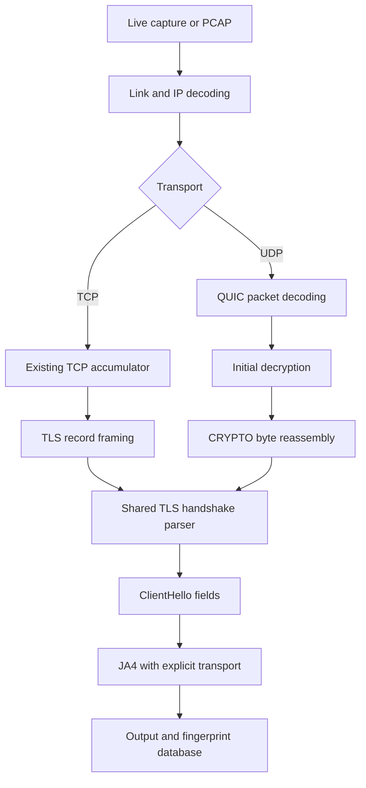

# Clarify Track B UDP/QUIC

> Dive into the UDP/QUIC part of our project (Track B) in detail. Here is a subset of things I want to get clarified from this conversation:
>
> 1. Theoretical prerequisites - gain networking conceptual depth sufficient for this project
> 2. Issues with the plan as it is currently laid out in the "CS 331 CN 2026/TLS-Fingerprinting/Phase 2/Phase2_team_share.md" doc, if any.
> 3. How independently can I work on this? Where will it lie in the whole end-to-end pipeline of our project? What other components of our project does work of this track directly depend upon?
> 4. A checklist of tasks I can follow during implementation
> 5. Implementation details and how to structure the code.
>
> This is a very rudimentary list and order, you should follow the order what you think makes sense for learning point of view. Also feel free to add or modify any items that you feel are also worth covering in the same conversation. Go!

<details><summary>10 previous messages</summary>

> I’ll read the Track B plan alongside the current code, then build the explanation from QUIC fundamentals through dependencies, plan gaps, and an implementation checklist. I’m using the learning skill to keep this grounded in both networking concepts and your project’s packet-level behavior.
>
> <details><summary>Explored a search, ran a command</summary>
>
> <details><summary>Explored a file, a search</summary>
>
> - Searched for `Phase 2|QUIC|Track B|revamp` in `MEMORY.md`
> - Read `~/.codex/plugins/cache/claude-cowork/anthropic-skills/1.0.0/skills/learn/SKILL.md`
>
> </details>
>
> - Ran `pwd; rg --files -g AGENTS.md -g CONTEXT.md -g Phase2_team_share.md -g '*quic*' -g '*QUIC*' -g pyvenv.cfg -g '!ja3/**' -g '!**/node_modules/**' -g '!**/build/**'`
>
> </details>
>
> What background should I assume for the walkthrough? I can start from TCP/UDP and TLS basics, then build up to QUIC packet decryption.
> - Start from networking and TLS basics
> - I know TCP/UDP and TLS; focus on QUIC
> - I know QUIC basics; focus on implementation
>
> <details><summary>Explored 5 files, ran a command</summary>
>
> <details><summary>Explored 5 files</summary>
>
> - Read `./AGENTS.md`
> - Read `./.agents/CONTEXT.md`
> - Read `./TLS-Fingerprinting/Phase 2/Phase2_team_share.md`
> - Read `~/.codex/memories/MEMORY.md`
> - Read `~/.codex/memories/rollout_summaries/2026-10-26T06-55-09-R2PJ-comparative_cpp_engine_revamp_review.md`
>
> </details>
>
> - Ran `rg --files --hidden 'TLS-Fingerprinting/Phase 2' -g '!**/.git/**' -g '!**/build*/**' -g '!**/.venv/**' -g '!**/node_modules/**'; rg --files --hidden -g pyvenv.cfg -g '!**/.git/**'; git status --short`
>
> </details>
>
> **What background should I assume for the walkthrough? I can start from TCP/UDP and TLS basics, then build up to QUIC packet decryption.**
>
> I know TCP/UDP and TLS; focus on QUIC
>
> <details><summary>Explored 10 files, 2 searches, a list, searched the web</summary>
>
> Searched the web for `https://www.rfc-editor.org/rfc/rfc9000.html`
>
> <details><summary>Explored 10 files, 2 searches, a list</summary>
>
> - Read `./TLS-Fingerprinting/Phase 2/engine/include/tlsfp/types.hpp`
> - Read `./TLS-Fingerprinting/Phase 2/engine/include/tlsfp/parser.hpp`
> - Read `./TLS-Fingerprinting/Phase 2/engine/include/tlsfp/capture.hpp`
> - Read `./TLS-Fingerprinting/Phase 2/engine/src/capture.cpp`
> - Read `./TLS-Fingerprinting/Phase 2/engine/src/ja4.cpp`
> - Read `./TLS-Fingerprinting/Phase 2/engine/include/tlsfp/ja4.hpp`
> - Read `./TLS-Fingerprinting/Phase 2/engine/CMakeLists.txt`
> - Read `./TLS-Fingerprinting/Phase 2/engine/include/tlsfp/byte_reader.hpp`
> - Read `./TLS-Fingerprinting/Phase 2/engine/src/parser.cpp`
> - Read `./TLS-Fingerprinting/Phase 2/engine/engine_roadmap.md`
> - Searched for `AF_PACKET|QUIC|UDP|JA4|TCP|pcap|zero.copy` in `kernel_hookpoints_and_architecture.md`
> - Searched for `quic|QUIC|transport|fingerprint|JA4` in `main.cpp`
> - Listed files in `TLS-Fingerprinting`
>
> </details>
>
> Searched the web for `https://www.rfc-editor.org/rfc/rfc8446.html`
>
> </details>
>
> Since you know TCP/UDP and TLS, I’ll focus on what QUIC changes. The main gap in the plan is that decrypting one Initial packet may yield only part of the ClientHello: Track B also needs bounded CRYPTO-data reassembly. The current engine has two integration gaps too—its TLS parser expects a record header, and its JA4 generator hardcodes TCP’s `t` prefix.
>
> <details><summary>Explored 6 files, 2 searches, a list, ran 5 commands, searched the web</summary>
>
> <details><summary>Explored 5 files, 2 searches, a list</summary>
>
> - Read `./TLS-Fingerprinting/Phase 2/engine/src/capture.cpp`
> - Read `./TLS-Fingerprinting/Phase 2/engine/src/ja4.cpp`
> - Read `./TLS-Fingerprinting/Phase 2/engine/src/parser.cpp`
> - Read `./TLS-Fingerprinting/Phase 2/engine/CMakeLists.txt`
> - Searched for `AF_PACKET|QUIC|UDP|JA4|TCP|pcap|zero.copy` in `kernel_hookpoints_and_architecture.md`
> - Searched for `quic|QUIC|transport|fingerprint|JA4` in `main.cpp`
> - Listed files in `TLS-Fingerprinting`
> - Read `./TLS-Fingerprinting/Phase 2/Phase2_team_share.md`
>
> </details>
>
> Searched the web for `https://www.rfc-editor.org/rfc/rfc9001.html`
>
> <details><summary>Explored 4 files</summary>
>
> - Read `./TLS-Fingerprinting/Phase 2/engine/src/ja4.cpp`
> - Read `./TLS-Fingerprinting/Phase 2/engine/src/parser.cpp`
> - Read `./TLS-Fingerprinting/Phase 2/engine/CMakeLists.txt`
> - Read `./TLS-Fingerprinting/Phase 2/engine/include/tlsfp/ja4.hpp`
>
> </details>
>
> - Ran `rg -n 'AF_PACKET|QUIC|UDP|zero.copy' 'TLS-Fingerprinting/Phase 2/kernel_hookpoints_and_architecture.md'; rg --files TLS-Fingerprinting -g '*pcap*' -g '*test*' -g '!**/.git/**' -g '!**/.venv/**' -g '!**/build*/**'; nl -ba 'TLS-Fingerprinting/Phase 2/Phase2_team_share.md' | sed -n '93,123p'; command -v tshark; .venv/bin/python -c 'import importlib.util; print({m: importlib.util.find_spec(m) is not None for m in ["cryptography", "scapy", "aioquic"]})'; git -C TLS-Fingerprinting status --short`
>
> Searched the web for `https://docs.openssl.org/3.0/man3/EVP_EncryptInit/`
>
> - Ran `tshark -r 'ja4/pcap/quic-with-several-tls-frames.pcapng' -Y 'quic && tls.handshake.type == 1' -T fields -e frame.number -e quic.version -e tls.handshake.type -e tls.handshake.extensions_alpn_str`
>
> - Ran `tshark -r 'ja4/pcap/quic-tls-handshake.pcapng' -Y 'quic && tls.handshake.type == 1' -T fields -e frame.number -e quic.version -e tls.handshake.type -e tls.handshake.extensions_alpn_str; rg -n 'ja3er|validated|match|JA4|QUIC' TLS-Fingerprinting/report/docs/09_testing_and_validation.md; nl -ba 'TLS-Fingerprinting/Phase 2/engine/src/parser.cpp' | sed -n '125,205p'; cat 'ja4/python/test/testdata/quic-with-several-tls-frames.pcapng.json'`
>
> Searched the web for `https://raw.githubusercontent.com/cloudflare/quiche/master/quiche/src/packet.rs`
>
> - Ran `.venv/bin/python - <<'PY'
> import hashlib, hmac, struct
> salt = bytes.fromhex('38762cf7f55934b34d179ae6a4c80cadccbb7f0a')
> dcid = bytes.fromhex('8394c8f03e515708')
> initial = hmac.new(salt, dcid, hashlib.sha256).digest()
> def expand_label(secret, label, length):
>     label = b'tls13 ' + label
>     info = struct.pack('!H', length) + bytes([len(label)]) + label + b'\x00'
>     return hmac.new(secret, info + b'\x01', hashlib.sha256).digest()[:length]
> client = expand_label(initial, b'client in', 32)
> actual = {name: expand_label(client, label, n).hex() for name, label, n in [('key', b'quic key', 16), ('iv', b'quic iv', 12), ('hp', b'quic hp', 16)]}
> expected = {'key': '1f369613dd76d5467730efcbe3b1a22d', 'iv': 'fa044b2f42a3fd3b46fb255c', 'hp': '9f50449e04a0e810283a1e9933adedd2'}
> assert actual == expected
> print('RFC 9001 Appendix A.1 client key/IV/HP vectors: 3/3 matched')
> for k, v in actual.items(): print(k + '=' + v)
> PY`
>
> - Ran `tshark -r 'ja4/pcap/quic-with-several-tls-frames.pcapng' -Y 'quic && tls.handshake.type == 1' -T fields -e frame.number -e quic.crypto.offset -e quic.crypto.length; nl -ba 'TLS-Fingerprinting/report/docs/09_testing_and_validation.md' | sed -n '260,293p'; rg -n 'JA4|ja4' 'ja4/wireshark/test/testdata/quic-with-several-tls-frames.pcapng.json' 'ja4/rust/ja4/src/snapshots/ja4__insta@quic-with-several-tls-frames.pcapng.snap' | head -n 15`
>
> Searched the web for `'sample_offset'`
>
> </details>
>
> There’s a useful teaching trace already in the repo: one QUIC Initial contains three CRYPTO frames at offsets 0, 36, and 169. Wireshark reconstructs an HTTP/3 ClientHello from them without a key log. I also checked the RFC’s published Initial key-derivation example in your existing virtual environment; the key, IV, and header-protection key all matched.
>
> I’ll use that trace to connect the wire format to the code structure, and distinguish the work you can do independently from the shared engine changes needed for integration.
>
> <details><summary>Explored 3 files, searched the web</summary>
>
> Searched the web for `https://www.rfc-editor.org/rfc/rfc9114.html`
>
> <details><summary>Explored 3 files</summary>
>
> - Read `~/.codex/memories/rollout_summaries/2026-10-26T06-55-09-R2PJ-comparative_cpp_engine_revamp_review.md`
> - Read `./ja4/rust/ja4/src/snapshots/ja4__insta@quic-with-several-tls-frames.pcapng.snap`
> - Read `./TLS-Fingerprinting/Phase 2/Phase2_team_share.md`
>
> </details>
>
> </details>
</details>

**Track B is a reasonably independent project, but the current plan understates its hardest part: reconstructing a complete ClientHello from decrypted QUIC traffic.** The cryptography is well specified and testable. Packet boundaries, connection state, reassembly, and integration with your existing TLS parser need more design.

I would define its deliverable as:

> Given captured QUIC v1 traffic, recover complete client Initial handshakes, extract their TLS fields, and produce validated QUIC JA4 fingerprints, with explicit reasons when recovery fails.

Since you already know TCP/UDP and TLS, let’s start with what QUIC changes.

**1. QUIC moves responsibilities that you currently associate with TCP and TLS.**

For this project, the useful comparison is:

| Existing TCP path | New QUIC path |
|---|---|
| TCP delivers an ordered byte stream | QUIC implements reliable delivery over UDP |
| TLS records frame handshake messages | QUIC CRYPTO frames carry TLS handshake bytes |
| TCP sequence numbers locate bytes | CRYPTO offsets locate handshake bytes |
| TLS ClientHello fields feed fingerprinting | The recovered ClientHello fields feed the same fingerprinting logic |

HTTP/3 is an application protocol carried over QUIC. QUIC can carry other applications too. Consequently, recognizing QUIC is insufficient to claim that you observed HTTP/3; a client offering ALPN `h3` supplies evidence of HTTP/3 support, but does not prove that an HTTP request completed. [HTTP/3 specification](https://www.rfc-editor.org/rfc/rfc9114.html)

The endpoint’s QUIC implementation handles acknowledgments, loss recovery, congestion control, and retransmission. Your passive observer only needs enough of that structure to recover handshake bytes. You need to understand those mechanisms, but you do not need to implement a sending QUIC endpoint. [QUIC recovery specification](https://www.rfc-editor.org/rfc/rfc9002.html)

The end-to-end placement should look like this:



**Track B owns the UDP-to-handshake branch.** The shared TLS parser and fingerprint generator are the points where it reconnects with the rest of the engine.

**2. Learn four distinct kinds of boundaries before studying the crypto.**

Much of QUIC parser correctness comes from keeping these separate:

| Object | Meaning |
|---|---|
| UDP datagram | One UDP payload delivered by IP |
| QUIC packet | A protected QUIC unit; a datagram can contain several |
| QUIC frame | A structure inside a decrypted packet |
| TLS handshake message | Bytes reconstructed from CRYPTO frame data |

A QUIC packet can contain multiple CRYPTO frames. A ClientHello can span multiple packets. Packet boundaries therefore do not determine ClientHello boundaries.

The client Initial header has this outline:

```text
First byte
Version
DCID length + DCID
SCID length + SCID
Token length + token
Length
Protected packet number
Protected payload + authentication tag
```

Token Length and Length use QUIC variable-length integers. Their first two bits select an encoded width of 1, 2, 4, or 8 bytes. The Initial’s Length covers its packet number and protected payload; it lets you locate that packet’s end within a coalesced datagram. [QUIC packet formats and integer encoding](https://www.rfc-editor.org/rfc/rfc9000.html#section-17.2.2)

Connection IDs are another important distinction. They identify QUIC connections independently of an IP/port tuple, supporting changes in network path. A four-tuple remains useful capture metadata, but should not be your entire QUIC connection model. [QUIC connection identifiers](https://www.rfc-editor.org/rfc/rfc8999.html#section-5)

**3. Initial encryption is deliberately recoverable by a passive observer.**

The apparent paradox is: *how can we decrypt anything without the server’s private key?*

QUIC Initial protection uses public inputs: a version-specific salt and the relevant client Initial DCID. Later protection levels use different secrets. Recovering an Initial therefore does not let you decrypt later HTTP traffic. Also, a valid Initial authentication tag does not establish endpoint identity: an observer can derive these Initial keys too. [QUIC Initial protection](https://www.rfc-editor.org/rfc/rfc9001.html#section-5.2)

For a client Initial, the derivation is:

```text
initial_secret = HKDF-Extract(v1_salt, initial_key_dcid)

client_secret = HKDF-Expand-Label(initial_secret, "client in", "", 32)

key = HKDF-Expand-Label(client_secret, "quic key", "", 16)
iv  = HKDF-Expand-Label(client_secret, "quic iv",  "", 12)
hp  = HKDF-Expand-Label(client_secret, "quic hp",  "", 16)
```

HKDF is a key derivation function. Extract produces an intermediate secret; Expand produces separate outputs for separate purposes. [HKDF specification](https://www.rfc-editor.org/rfc/rfc5869.html)

`HKDF-Expand-Label` adds TLS’s structured label encoding, including the literal `"tls13 "` prefix. Passing only `"quic key"` directly to a generic HKDF function produces the wrong result. [TLS label encoding](https://www.rfc-editor.org/rfc/rfc8446.html#section-7.1)

I checked the published example using your existing `.venv`. For DCID `8394c8f03e515708`, all three outputs matched:

```text
key = 1f369613dd76d5467730efcbe3b1a22d
iv  = fa044b2f42a3fd3b46fb255c
hp  = 9f50449e04a0e810283a1e9933adedd2
```

That validates the derivation exercise; it is not an end-to-end validation of a project QUIC implementation.

There is a subtle state requirement: retain the DCID used for Initial key derivation. Do not derive fresh keys from every subsequent packet’s current DCID. Retry changes the derivation context, and server Initial packets use the client Initial’s derivation context with the server-direction secret. [Initial key selection](https://www.rfc-editor.org/rfc/rfc9001.html#section-5.2)

**4. Header protection removal and payload decryption are separate operations.**

The decryption pipeline should have visible intermediate stages:

| Stage | What it establishes |
|---|---|
| Parse exposed header fields | Version, IDs, token, packet boundary, packet-number offset |
| Remove header protection | Actual first-byte fields and encoded packet number |
| Reconstruct packet number | Full number needed for the nonce |
| Authenticate and decrypt payload | Plaintext QUIC frames |
| Decode frames | CRYPTO byte ranges |

For header protection, take a 16-byte ciphertext sample beginning **four bytes after the packet-number offset**. Generate the AES mask, unmask the first byte, then determine the packet-number length and unmask those bytes. Reading the protected length bits first is a common mistake. Cloudflare’s implementation shows this ordering explicitly. [quiche header decoding](https://github.com/cloudflare/quiche/blob/master/quiche/src/packet.rs)

The packet number is a packet identifier, not a byte offset. It can be transmitted in truncated form; recovering its full value needs packet-number context. Repeated handshake data can appear in packets with different numbers, so packet-number deduplication cannot replace byte-range reassembly. [QUIC packet-number and recovery model](https://www.rfc-editor.org/rfc/rfc9002.html#section-4)

For payload decryption:

```text
nonce = iv XOR zero_left_padded_full_packet_number
AAD   = unprotected header through the packet number
```

The nonce construction is also visible in [quiche’s cryptographic implementation](https://github.com/cloudflare/quiche/blob/master/quiche/src/crypto/mod.rs).

Use OpenSSL’s EVP interface for AES-128-GCM. Supply the associated data and expected tag, then require authentication to succeed before consuming any plaintext. `EVP_DecryptUpdate` producing bytes is insufficient; the final authentication result matters. [OpenSSL authenticated decryption](https://docs.openssl.org/3.0/man3/EVP_EncryptInit/)

This ordering gives you a practical debugging method: compare header fields, derived keys, unprotected header, packet number, and plaintext separately. A wrong final JA4 otherwise hides every possible upstream error.

**5. CRYPTO reassembly is the main networking algorithm you need to own.**

A CRYPTO frame supplies a type, offset, length, and data. Its offset locates bytes within the handshake data for that direction and encryption level. [CRYPTO frame specification](https://www.rfc-editor.org/rfc/rfc9000.html#section-19.6)

Your repository already contains an excellent small example:

[quic-with-several-tls-frames.pcapng](~/Projects/CS%20331%20CN%202026/ja4/pcap/quic-with-several-tls-frames.pcapng)

I inspected it with TShark. Its first packet contains these CRYPTO ranges:

| Offset | Length | Covered interval |
|---:|---:|---|
| 0 | 36 | `[0, 36)` |
| 36 | 133 | `[36, 169)` |
| 169 | 126 | `[169, 295)` |

Together, they provide 295 contiguous handshake bytes. TShark reconstructs a ClientHello offering `h3` without a supplied key log.

Now imagine receiving those ranges in this order:

```text
[169,295), [0,36), [36,169)
```

Appending data in arrival order produces corrupted input. Placing each range at its declared offset reconstructs the original message.

For the first ClientHello, completion means:

1. Bytes `[0,4)` are available.
2. The handshake type is ClientHello.
3. Its three-byte length gives body length `L`.
4. Every byte in `[0,4+L)` is available.

**A large allocation or a large highest-observed offset does not prove completeness.**

I recommend a bounded buffer plus a received-byte bitmap for the first implementation. It is easy to explain and inspect. Define these policies explicitly:

- Identical overlapping bytes are accepted.
- Conflicting overlapping bytes invalidate the attempt.
- Missing ranges keep the result incomplete.
- Excessive offsets or message lengths produce a limit result.
- Completed attempts retain enough short-lived state to suppress duplicate output.

Also walk the decrypted frame sequence properly. Support PADDING, PING, ACK/ACK_ECN, CRYPTO, and transport CONNECTION_CLOSE for the Initial scope. Reject or stop safely on an unsupported frame whose size you cannot determine. Searching plaintext for byte `0x06` will produce false CRYPTO frames.

**6. The plan has the right direction, but needs these corrections.**

These apply to the current [Track B section](~/Projects/CS%20331%20CN%202026/TLS-Fingerprinting/Phase%202/Phase2_team_share.md:76).

| Plan statement or omission | Assessment and correction |
|---|---|
| Capture UDP port 443 | Sensible initial capture scope. Keep the decoder independent of port numbers so local tests can use other ports. |
| Decode Long Header and Initial | Add variable integers, token handling, coalesced packets, bounds checks, and explicit unsupported-version handling. |
| Derive secrets with HKDF-Expand-Label | Add the preceding HKDF-Extract step and specify label encoding and direction. |
| “Decrypt the CRYPTO frame payload” | Decrypt and authenticate the QUIC packet payload first; decode its frames afterward. |
| No CRYPTO reassembly task | Add it as a first-class milestone, including reordering, duplicates, overlaps, gaps, and resource limits. |
| Feed the recovered ClientHello into existing parsing | Add a handshake-level parser entry point; the current parser expects a TLS record. |
| Output `q13...` | Make transport an explicit JA4 input and validate every component of the fingerprint. |
| “15-line Python script” | Reasonable for a narrow crypto experiment; misleading as an estimate for packet recovery. |
| Ignore “obsolete drafts and v2” | Excluding v2 is a valid scope choice, but v2 is a standardized version. Report it as unsupported. |
| “Over 30%” of web traffic | Supply a dated source and measurement definition, or remove the numerical claim. |

QUIC v2 changes packet types and cryptographic constants/labels. Parse the version before applying v1-specific interpretation. [QUIC v2 specification](https://www.rfc-editor.org/rfc/rfc9369.html)

There are two broader planning issues relevant to your track:

- The foundation’s “standard handshakes fit in one MTU” assumption is unsuitable for Track B. Make complete-message recovery independent of packet size.
- “Zero-copy” needs qualification. Decryption produces plaintext storage, and fragmented handshakes need retained bytes. Minimize unnecessary copies, but choose clear buffer ownership over a blanket zero-copy claim.

The plan should also explicitly limit the first release to **client JA4**. Server Initial recovery and server fingerprinting introduce additional direction and correlation work.

**7. You can work independently on most of this, with three shared integration boundaries.**

| Component | Independence |
|---|---|
| QUIC integer/header decoder | Fully independent, using byte fixtures |
| Initial key derivation | Fully independent, using RFC vectors |
| Header protection and AEAD | Fully independent, using published packet vectors |
| Frame decoder | Fully independent, using plaintext fixtures |
| CRYPTO reassembler | Fully independent, using synthetic byte ranges |
| UDP capture dispatch | Shared change in capture code |
| Handshake parser extraction | Shared change in TLS parsing |
| JA4 transport parameter and output event | Shared interface change |
| Redis and client catalog | Downstream; unnecessary for proving recovery |

You have no functional dependency on Track A’s JA4T work. JA4T uses TCP SYN information, which QUIC does not provide. A QUIC event should mark that correlation as **not applicable**, rather than treating its absence as suspicious.

Track C supplies valuable large-handshake and ECH experiments, but should not block your core decoder. For ECH traffic, your result describes the visible outer ClientHello; Initial decryption does not remove ECH’s separate protection.

There is also a distinction between technical independence and the team’s process. The plan currently requires the foundation to merge before feature C++ coding. Under that rule, you can immediately do RFC exercises, fixture preparation, Python experiments, interface design, and test planning. C++ feature work follows the stated foundation gate.

Your project documentation records the earlier JA3 community-validation work in [testing and validation](~/Projects/CS%20331%20CN%202026/TLS-Fingerprinting/report/docs/09_testing_and_validation.md:269). Retain that evidence so the project’s required JA3-before-JA4 sequence remains demonstrable.

**8. Structure the code around protocol stages and reuse the field parser.**

The existing engine gives you useful building blocks, but four concrete changes are needed:

| Current code | Required integration |
|---|---|
| [Capture options default to `tcp`](~/Projects/CS%20331%20CN%202026/TLS-Fingerprinting/Phase%202/engine/include/tlsfp/capture.hpp:13) | Expand the default capture scope while preserving existing TCP coverage |
| [IP decoding rejects non-TCP traffic](~/Projects/CS%20331%20CN%202026/TLS-Fingerprinting/Phase%202/engine/src/capture.cpp:307) | Dispatch validated IP payloads to TCP or UDP handlers |
| [ClientHello parser consumes a TLS record header](~/Projects/CS%20331%20CN%202026/TLS-Fingerprinting/Phase%202/engine/src/parser.cpp:180) | Extract shared parsing of a complete handshake message |
| [JA4 hardcodes `t`](~/Projects/CS%20331%20CN%202026/TLS-Fingerprinting/Phase%202/engine/src/ja4.cpp:125) | Accept an explicit TCP/QUIC transport argument |

A proposed layout under the existing engine is:

```text
include/tlsfp/
    quic/
        packet.hpp       Header decoding, packet boundaries, varints
        crypto.hpp       Initial keys and packet protection removal
        frames.hpp       Frame decoding
        reassembly.hpp   Bounded CRYPTO byte recovery
        tracker.hpp      Connection attempts, direction, expiry
    events.hpp           Shared owning output events

src/
    quic/
        packet.cpp
        crypto.cpp
        frames.cpp
        reassembly.cpp
        tracker.cpp

tests/
    quic/
        ...
```

These are responsibility boundaries; you can combine small files initially.

The key shared interfaces could have this shape:

```cpp
parse_client_hello_handshake(handshake_bytes, client_fields);
compute_ja4(client_fields, Transport::QUIC);
```

Keep the existing TCP record parser as a wrapper that validates record framing and calls the shared handshake parser. QUIC supplies reconstructed handshake bytes directly. Avoid creating a second implementation of ClientHello extension parsing.

The engine currently uses C++17, so use a small pointer-and-length byte view unless the team deliberately changes the language standard.

Three implementation decisions deserve particular care:

**Connection state.** Store the Initial key context, observed connection-ID associations, packet-number context, CRYPTO recovery state, last-seen capture timestamp, and emission status. Keep direction explicit. Treat Retry as a separate attempt/key context and define whether it is supported initially or reported as a coverage limitation.

**Buffer ownership.** The existing [ClientHelloData](~/Projects/CS%20331%20CN%202026/TLS-Fingerprinting/Phase%202/engine/include/tlsfp/parser.hpp:29) contains `string_view` fields. Those views can point into QUIC plaintext storage. Compute fingerprints while that storage is alive, and copy strings into any event that outlives it. Never queue an event containing views into a temporary decryption buffer.

**Failure reporting.** Distinguish results such as:

```text
unsupported_version
malformed_packet
authentication_failed
incomplete_handshake
resource_limit
fingerprint_emitted
```

Authentication failure alone does not prove malicious traffic; incorrect context or an incomplete capture can also prevent recovery.

For bounds, choose a documented per-handshake cap, maximum concurrent attempts, and timeout. Check `offset + length` safely before allocation. Use capture timestamps for offline expiry so replay speed does not change results.

The existing [CMake configuration](~/Projects/CS%20331%20CN%202026/TLS-Fingerprinting/Phase%202/engine/CMakeLists.txt) already links OpenSSL Crypto. It currently contains no test target, so adding executable QUIC tests must be part of the work.

**9. Follow this implementation checklist, with a pass condition at each stage.**

| Stage | Tasks | Pass condition |
|---|---|---|
| **1. Freeze scope** | Specify v1, client Initials, supported capture forms, Retry policy, limits, output schema | Written support matrix |
| **2. Establish fixtures** | Save RFC vectors, small QUIC captures, expected decoded fields, capture provenance | Tests run offline without external services |
| **3. Decode headers** | Implement bounded reads, varints, IDs, token, lengths, packet iteration | Correct offsets and clean rejection of truncated inputs |
| **4. Derive keys** | Implement Extract and structured Expand-Label | Exact RFC intermediate values |
| **5. Recover plaintext** | Remove protection, reconstruct packet number, build nonce/AAD, verify GCM | Exact RFC packet plaintext; altered packets rejected |
| **6. Decode frames** | Walk supported Initial frame types | Correct CRYPTO ranges amid ACK/PADDING |
| **7. Reassemble handshake** | Handle gaps, reordering, duplicates, overlaps, expiry and caps | Same ClientHello bytes across equivalent packetizations |
| **8. Share TLS parsing** | Extract handshake parser and preserve TCP wrapper | Existing TCP field extraction remains unchanged |
| **9. Produce JA4** | Add transport input, inspect raw components, compare independent reference | Complete expected `q...` fingerprint matches |
| **10. Integrate capture/output** | Add UDP dispatch, counters, events, database lookup | Mixed TCP/QUIC capture yields correct events |
| **11. Demonstrate limits** | Exercise unsupported versions, missing packets, oversized messages, ECH | Each limitation produces an explainable outcome |

For stage 9, a leading `q` is only the beginning. Validate TLS-version resolution, cipher/extension counts, GREASE handling, ALPN encoding, and both hash inputs. The JA4 specification defines these independently of your transport decoder. [Official JA4 algorithm](https://github.com/FoxIO-LLC/ja4/blob/main/technical_details/JA4.md)

The repository’s [reference snapshot](~/Projects/CS%20331%20CN%202026/ja4/rust/ja4/src/snapshots/ja4__insta@quic-with-several-tls-frames.pcapng.snap:12) records this result for the three-CRYPTO-frame capture:

```text
q13d0310h3_55b375c5d22e_cd85d2d88918
```

Use it as a comparison target, with the reference revision recorded. I verified TShark’s handshake reconstruction; I have not computed that JA4 through new project code.

Your most valuable boundary tests are:

- Every supported variable-integer width, including truncated encodings.
- Several QUIC packets in one UDP datagram.
- Several CRYPTO frames in one packet.
- A ClientHello split across datagrams and delivered out of order.
- Identical and conflicting overlaps.
- Missing bytes that never arrive.
- Packet-number reconstruction boundaries.
- Wrong keys, altered headers, altered ciphertext, and bad tags.
- Excessive offsets, lengths, and concurrent attempts.
- A retransmitted complete ClientHello producing one event.
- Mixed TCP and UDP traffic without changing TCP results.

The invariant worth explaining in your presentation is:

> Equivalent recovered ClientHello bytes produce the same fingerprint, regardless of packetization, arrival order, or identical retransmissions within the supported capture model.

**10. Build the demonstration around evidence, including failure cases.**

For controlled HTTP/3 traffic, use an HTTP/3-capable curl build and `--http3-only`; `--http3` allows fallback, which could leave you demonstrating the existing TCP path unintentionally. [curl’s HTTP/3 documentation](https://curl.se/docs/http3.html)

Record a short progression:

```text
Captured datagram
→ decoded Initial
→ authenticated plaintext
→ CRYPTO ranges
→ complete ClientHello
→ extracted fields
→ JA4 components
→ final event
```

Then replay a reordered/duplicated fixture and show that its fingerprint stays the same. Remove one necessary range and show an incomplete result. Corrupt ciphertext and show authentication failure. Feed v2 and show an unsupported-version result.

Report counts at each stage—candidate datagrams, Initial packets, authenticated packets, completed handshakes, emitted fingerprints—and explain the differences. That gives the evaluator evidence of both correctness and coverage.

Your local setup already has TShark and a `.venv`; that environment currently lacks `cryptography`. OpenSSL Crypto is already part of the C++ engine. No dependencies or project files were changed during this review.

The best first learning exercise is the existing three-CRYPTO-frame trace: annotate its packet boundary, packet-number offset, frame ranges, and reconstructed handshake length. Once you can explain those bytes, the proposed module boundaries have a concrete reason to exist.
