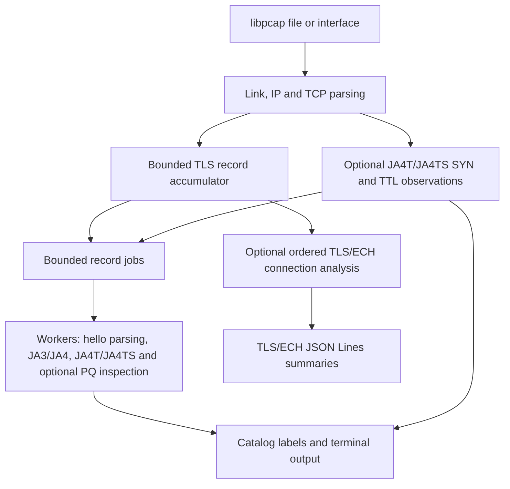

User: Given packets from a live interface or a PCAP/PCAPNG file, extract supported visible TLS hellos, compute JA3/JA3S and JA4/JA4S, and report additional transport and key-exchange observations. Inputs may contain segmented records, retransmissions, coalesced records, missing packets, or incomplete connections. Outputs are terminal fingerprints and catalog labels, optional TCP-based alerts, verbose inspection, and optional TLS/ECH JSON Lines summaries.

The engineering problem is to connect packet-level explanations with bounded processing and honest uncertainty. The project extends its earlier fingerprint-only pipeline; it does not establish a general weakness in existing monitoring products. Capture requires access to the relevant traffic. Both directions improve correlation, while missing SYNs or hellos reduce the available evidence. The engine supports TCP rather than QUIC/UDP, does not decrypt ECH or application traffic, and does not guarantee application recognition, successful TLS completion, or attack detection.

see if this is consistent with what we have made. if not then tell me what line/s are wrong

Copilot: I’ll compare each capability claim against the implementation and documentation, then report only the specific lines that are inaccurate or overstated.

Find files matching `**/*.{md,cpp,h,hpp,py,cmake,txt}`

Search for `JA3|JA4|ECH|PCAP|pcap|retrans|reassembl|TCP|QUIC|UDP|live interface|interface...`

Ran terminal command: git --no-pager status --short && git --no-pager log -5 --oneline

"Read" failed
Completed with input: {
  "path": "/Users/satyakammishra/Documents/Github Repos/TLS/TLS-Fingerprinting/Phase 2/README.md",
  "view_range": [
    1,
    240
  ]
}
Tool execution failed: view_range out of bounds

Read , lines 1 to 260
Completed with input: {
  "path": "/Users/satyakammishra/Documents/Github Repos/TLS/TLS-Fingerprinting/Phase 2/report/report.md",
  "view_range": [
    1,
    260
  ]
}

Read , lines 1 to 260
Completed with input: {
  "path": "/Users/satyakammishra/Documents/Github Repos/TLS/TLS-Fingerprinting/Phase 2/code/engine/src/main.cpp",
  "view_range": [
    1,
    260
  ]
}

Read , lines 1 to 220
Completed with input: {
  "path": "/Users/satyakammishra/Documents/Github Repos/TLS/TLS-Fingerprinting/Phase 2/code/engine/include/tlsfp/capture.hpp",
  "view_range": [
    1,
    220
  ]
}

Read , lines 1 to 300
Completed with input: {
  "path": "/Users/satyakammishra/Documents/Github Repos/TLS/TLS-Fingerprinting/Phase 2/code/engine/src/capture.cpp",
  "view_range": [
    1,
    300
  ]
}

Read , lines 1 to 240
Completed with input: {
  "path": "/Users/satyakammishra/Documents/Github Repos/TLS/TLS-Fingerprinting/Phase 2/code/engine/include/tlsfp/accumulator.hpp",
  "view_range": [
    1,
    240
  ]
}

Search for `pcap_open_offline|pcap_open_live|pcap_loop|pcap_next|PCAPNG|DLT_|max_connecti...`

Read , lines 1 to 360
Completed with input: {
  "path": "/Users/satyakammishra/Documents/Github Repos/TLS/TLS-Fingerprinting/Phase 2/code/engine/src/accumulator.cpp",
  "view_range": [
    1,
    360
  ]
}

Read , lines 1 to 300
Completed with input: {
  "path": "/Users/satyakammishra/Documents/Github Repos/TLS/TLS-Fingerprinting/Phase 2/code/engine/include/tlsfp/types.hpp",
  "view_range": [
    1,
    300
  ]
}

Read , lines 1 to 240
Completed with input: {
  "path": "/Users/satyakammishra/Documents/Github Repos/TLS/TLS-Fingerprinting/Phase 2/code/engine/src/ja4.cpp",
  "view_range": [
    1,
    240
  ]
}

Read , lines 1 to 240
Completed with input: {
  "path": "/Users/satyakammishra/Documents/Github Repos/TLS/TLS-Fingerprinting/Phase 2/code/engine/src/pqtls_analysis.cpp",
  "view_range": [
    1,
    240
  ]
}

The implementation largely matches the description, but I’m checking the boundary cases that determine whether “supports” is too broad—especially JSON contents, record/message reassembly, and loss handling.

Search for `json_filename|jsonl|JSON|connection summary|write.*json|json.*write|ech_analy...`

Read , lines 500 to 900
Completed with input: {
  "path": "/Users/satyakammishra/Documents/Github Repos/TLS/TLS-Fingerprinting/Phase 2/code/engine/src/capture.cpp",
  "view_range": [
    500,
    900
  ]
}

Read , lines 900 to 1250
Completed with input: {
  "path": "/Users/satyakammishra/Documents/Github Repos/TLS/TLS-Fingerprinting/Phase 2/code/engine/src/capture.cpp",
  "view_range": [
    900,
    1250
  ]
}

Read , lines 120 to 430
Completed with input: {
  "path": "/Users/satyakammishra/Documents/Github Repos/TLS/TLS-Fingerprinting/Phase 2/code/engine/src/parser.cpp",
  "view_range": [
    120,
    430
  ]
}

Read , lines 1 to 220
Completed with input: {
  "path": "/Users/satyakammishra/Documents/Github Repos/TLS/TLS-Fingerprinting/Phase 2/report/docs/Phase2_Unified_End_Goal_and_Review_Charter.md",
  "view_range": [
    1,
    220
  ]
}

Ran terminal command: nl -ba 'Phase 2/report/report.md' | sed -n '35,58p;100,145p'

Ran terminal command: nl -ba 'Phase 2/code/engine/src/accumulator.cpp' | sed -n '35,165p;175,204p'

Ran terminal command: nl -ba 'Phase 2/code/engine/src/capture.cpp' | sed -n '680,715p;925,955p;1085,1120p;1830,1945p'

Ran terminal command: nl -ba 'Phase 2/code/engine/src/parser.cpp' | sed -n '190,235p;295,330p;350,390p'

Ran terminal command: nl -ba 'Phase 2/report/report.md' | sed -n '45,75p'

Ran terminal command: nl -ba 'Phase 2/code/engine/src/capture.cpp' | sed -n '694,710p;933,946p;1088,1110p'

Ran terminal command: nl -ba 'Phase 2/code/engine/src/accumulator.cpp' | sed -n '88,145p;158,204p'

Ran terminal command: nl -ba 'Phase 2/code/engine/src/main.cpp' | sed -n '20,42p;116,126p'

Mostly consistent, but line 59 is too broad.

| Line | Issue | Correction |
|---|---|---|
| 59 | “segmented records” could imply arbitrary TLS handshake reassembly. | Only TLS **records** split across TCP segments are supported; a `ClientHello`/`ServerHello` spanning multiple TLS records is unsupported ([parser.cpp:354](<.../Phase%202/code/engine/src/parser.cpp:354>)). |
| 59 | “missing packets” suggests recovery after loss. | After TLS framing begins, a TCP gap stops that direction and marks it incomplete; there is no out-of-order queue ([accumulator.cpp:92](<.../Phase%202/code/engine/src/accumulator.cpp:92>)). |
| 59 | Retransmission support is limited. | Already-delivered retransmissions/overlaps are suppressed, but arbitrary reordering is not supported ([accumulator.cpp:97](<.../Phase%202/code/engine/src/accumulator.cpp:97>)). |
| 59 | “key-exchange observations” sounds always enabled. | PQ-TLS observations require `-p/--pq`; otherwise only normal TLS fingerprints and optional ECH analysis run ([main.cpp:33](<.../Phase%202/code/engine/src/main.cpp:33>)). |
| 61 | “honest uncertainty” is accurate, but should mention the 8-KB record limit. | Records larger than 8192 bytes are reported as unsupported ([parser.cpp:232](<.../Phase%202/code/engine/src/parser.cpp:232>)), which can affect large PQ/ECH hellos. |

The rest is consistent: live capture and PCAP/PCAPNG input, JA3/JA3S/JA4/JA4S, JA4T alerts, catalog labels, verbose output, JSON Lines, TCP-only processing, no ECH decryption, and no guaranteed application/attack recognition are all represented in the implementation.

User: ok, so give me updated code for these. Also JA4T and JA4TS is implemented. Also make minimal changes and give me the md code here only. 

## II. Problem Statement

Given packets from a live interface or a PCAP/PCAPNG file, extract supported visible TLS hellos, compute JA3/JA3S and JA4/JA4S, and report additional transport and key-exchange observations. Inputs may contain segmented records, retransmissions, coalesced records, missing packets, or incomplete connections. Outputs are terminal fingerprints and catalog labels, optional TCP-based alerts, verbose inspection, and optional TLS/ECH JSON Lines summaries.

The engineering problem is to connect packet-level explanations with bounded processing and honest uncertainty. The project extends its earlier fingerprint-only pipeline; it does not establish a general weakness in existing monitoring products. Capture requires access to the relevant traffic. Both directions improve correlation, while missing SYNs or hellos reduce the available evidence. The engine supports TCP rather than QUIC/UDP, does not decrypt ECH or application traffic, and does not guarantee application recognition, successful TLS completion, or attack detection.

## III. Project Objectives

1. Compute the four TLS fingerprints and check representative known-answer vectors.
2. Handle complete records and supported TCP segmentation with explicit size and state limits.
3. Correlate SYN/SYN-ACK metadata with hellos and exercise honest, inconsistent, and fully spoofed synthetic controls.
4. Extract ECH envelope fields while separating presence, parse status, findings, and acceptance evidence.
5. Inspect advertised PQ groups and key-share sizes without claiming cryptographic verification.
6. Evaluate current engine modes on identical captures with recorded settings and reproducible counts.

Copilot: ```md
## II. Problem Statement

Given packets from a live interface or a PCAP/PCAPNG file, extract supported visible TLS hellos, compute JA3/JA3S and JA4/JA4S, and report transport fingerprints (JA4T/JA4TS) and optional key-exchange observations. Inputs may contain TLS records split across TCP segments, retransmissions, coalesced records, missing packets, or incomplete connections. Outputs include terminal fingerprints, catalog labels, optional JA4T/JA4TS cross-layer alerts, verbose inspection, and optional TLS/ECH JSON Lines summaries.

The engineering problem is to connect packet-level explanations with bounded processing and honest uncertainty. The project extends its earlier fingerprint-only pipeline; it does not establish a general weakness in existing monitoring products. Capture requires access to the relevant traffic. Both directions improve correlation, while missing SYNs or hellos reduce the available evidence. Already-delivered retransmissions are suppressed, but arbitrary out-of-order recovery is not provided. TLS records larger than the engine's 8192-byte supported limit, and hellos spanning multiple TLS records, are reported as unsupported or incomplete. The engine supports TCP rather than QUIC/UDP, does not decrypt ECH or application traffic, and does not guarantee application recognition, successful TLS completion, or attack detection.

## III. Project Objectives

1. Compute the four TLS fingerprints and check representative known-answer vectors.
2. Handle complete TLS records and supported TCP segmentation with explicit size and state limits.
3. Compute JA4T/JA4TS fingerprints, correlate SYN/SYN-ACK metadata with TLS hellos, and exercise honest, inconsistent, and fully spoofed synthetic controls.
4. Extract ECH envelope fields while separating presence, parse status, findings, and acceptance evidence.
5. Optionally inspect advertised PQ groups and key-share sizes without claiming cryptographic verification.
6. Evaluate current engine modes on identical captures with recorded settings and reproducible counts.
```

User: ```mermaid
flowchart TD
    A["libpcap file or interface"] --> B["Link, IP and TCP parsing"]
    B --> C["Bounded TLS record accumulator"]
    B --> D["Optional SYN and TTL observations"]
    C --> E["Bounded record jobs"]
    D --> E
    E --> F["Workers: hello parsing, JA3/JA4, PQ inspection"]
    F --> G["Catalog labels and terminal output"]
    D --> G
    C --> H["Optional ordered TLS/ECH connection analysis"]
    H --> I["TLS/ECH JSON Lines summaries"]
```

*Figure 1. Capture-thread state is separate from worker reporting. The JSON branch does not include the terminal JA4T/PQ findings.*

The capture thread parses link, IP and TCP headers and owns record accumulation. With ECH tracking enabled, it also owns bidirectional connection generations, lifecycle state, and JSON output. Each complete record sent to a worker is copied into a bounded job, including any captured SYN and TTL context. A symmetric flow hash sends both directions to the same worker. Workers have separate parser scratchpads and PQ offer tables, and terminal output is synchronized [2].

The accumulator can borrow bytes for a complete record and allocate storage for an unfinished one. This reduces copying at record delivery, but worker jobs still copy records: the whole pipeline is not zero-copy. In stateful tracking, sequence watermarks suppress delivered retransmissions; partial overlaps retain only the new suffix. A gap after framing starts stops that direction. There is no general out-of-order queue. Split record headers and multiple records in one segment are supported; a hello spanning multiple TLS records is not. The central stateful rule is:

```text
discard already-delivered prefix bytes; keep any new suffix
if a gap breaks established framing: stop this direction
read or complete the five-byte TLS record header
if total record size exceeds 8192: report unsupported input
retain partial bytes until complete; then deliver the record
repeat for any remaining records in the segment
```

An assembled record is limited to 8,192 bytes including its five-byte header. Incomplete-record timeout is three seconds; default ECH connection timeout is 30 seconds, with at most 65,536 retained connections. These are implementation limits, not TLS protocol guarantees. Bounded worker queues make offline capture wait when full; live dispatch may drop jobs. Ordered producer state simplifies ownership at the cost of serial work and some repeated parsing. Consumer threads drain before capture returns.

Verify if there is any inconsistency otherwise tell me that there is and give me the md code in this chat only

Copilot: Search for `connection_timeout_seconds|max_connections|FLOW_TIMEOUT_SECONDS|connection_ti...`

Search for `FLOW_TIMEOUT_SECONDS|max_connections|connection_timeout_seconds`

Read , lines 340 to 450
Completed with input: {
  "path": "/Users/satyakammishra/Documents/Github Repos/TLS/TLS-Fingerprinting/Phase 2/code/engine/src/capture.cpp",
  "view_range": [
    340,
    450
  ]
}

Read , lines 1180 to 1398
Completed with input: {
  "path": "/Users/satyakammishra/Documents/Github Repos/TLS/TLS-Fingerprinting/Phase 2/code/engine/src/capture.cpp",
  "view_range": [
    1180,
    1398
  ]
}

```md


*Figure 1. Capture-thread state is separate from worker reporting. The JSON branch does not include the terminal JA4T/JA4TS or PQ findings.*

The capture thread parses link, IP and TCP headers and owns record accumulation. With ECH tracking enabled, it also owns bidirectional connection generations, lifecycle state, and JSON output. Each complete record sent to a worker is copied into a bounded job, including any captured SYN and TTL context. A symmetric flow hash sends both directions to the same worker. Workers have separate parser scratchpads and PQ offer tables, and terminal output is synchronized [2].

The accumulator can borrow bytes for a complete record and allocate storage for an unfinished one. This reduces copying at record delivery, but worker jobs still copy records: the whole pipeline is not zero-copy. In stateful tracking, sequence watermarks suppress delivered retransmissions; partial overlaps retain only the new suffix. A gap after framing starts stops that direction. There is no general out-of-order queue. Split record headers and multiple records in one segment are supported; a hello spanning multiple TLS records is not. The central stateful rule is:

```text
discard already-delivered prefix bytes; keep any new suffix
if a gap breaks established framing: stop this direction
read or complete the five-byte TLS record header
if total record size exceeds 8192: report unsupported input
retain partial bytes until complete; then deliver the record
repeat for any remaining records in the segment
```

An assembled record is limited to 8,192 bytes including its five-byte header. Incomplete-record timeout is three seconds; the default stateful connection timeout is 30 seconds, with at most 65,536 retained connections. These are implementation limits, not TLS protocol guarantees. Bounded worker queues make offline capture wait when full; live dispatch may drop jobs. Ordered producer state simplifies ownership at the cost of serial packet-state processing and some repeated parsing. Consumer threads drain before capture returns.
```