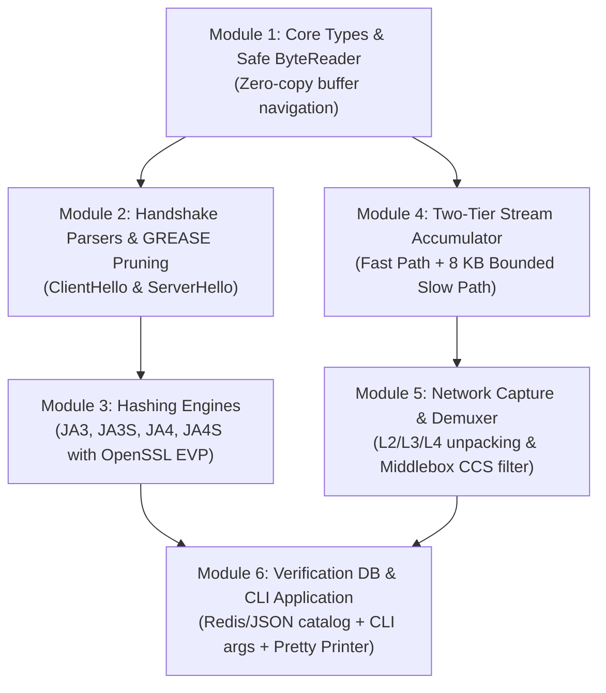

# Phase 2 C++ Engine Roadmap: Clean, High-Performance TLS Fingerprinter

**CS 331 Computer Networks — Project 11 (Team T014)**  
**Target:** Clean-slate, high-throughput CLI engine for TCP-TLS fingerprinting (`JA3`, `JA3S`, `JA4`, `JA4S`) with verification database.  
**Location:** `Phase 2/engine/`

---

## 1. Engine Scope & Design Principles

### Scope Boundaries
- **In Scope:**
  - Fast, zero-copy packet demuxing from `AF_PACKET` (`libpcap`) for live interfaces and offline `.pcap` files.
  - Two-Tier Stream Handler (Fast Path for $\le$ MTU / GRO-on + Slow Path 8 KB Bounded Accumulator for fragmented handshakes / GRO-off).
  - Robust byte-level TLS 1.2 and 1.3 parser for `ClientHello` and `ServerHello`.
  - In-place GREASE filtering (RFC 8701).
  - Exact fingerprint generation: **JA3**, **JA3S**, **JA4**, and **JA4S**.
  - Verification & catalog subsystem (Standalone Redis RESP client + JSON fallback).
  - Interactive & non-interactive CLI application (`-r`, `-i`, `-f`, `-v`, `-q`, `-a`).
- **Strictly Out of Scope for this Core Engine (Deferred to Feature Branches):**
  - No QUIC/UDP (Track B).
  - No JA4T TCP options parsing or kernel evasion detection (Track A).
  - No ECH HPKE decryption or DNS side-channel analysis (Track C).
  - No complex user-space TCP reassembly state machine (RFC 793).

### Key Architectural Tenets
1. **Zero Heap Allocations on Fast Path:** Reusable thread-local scratchpads for parsing and hashing.
2. **Deterministic Two-Tier Stream Accumulation:** 
   - Fast Path handles single-packet handshakes zero-copy.
   - Slow Path handles multi-packet handshakes up to 8192 bytes using explicit TLS record lengths.
3. **Strict Parity with Phase 1 Baselines:** Must produce identical JA3/JA4 hashes across all 7 ground-truth PCAPs.

---

## 2. Target File & Directory Structure

We will structure the code cleanly inside `Phase 2/engine/`:

```
Phase 2/engine/
├── CMakeLists.txt              # Isolated build configuration for Phase 2 engine
├── engine_roadmap.md           # This architecture & implementation roadmap
├── include/
│   └── tlsfp/
│       ├── types.hpp           # Common types (FlowKey, Fingerprints, Record Types)
│       ├── byte_reader.hpp     # Zero-copy safe memory slice & Big-Endian reader
│       ├── parser.hpp          # Handshake structures, ClientHello & ServerHello decoders
│       ├── accumulator.hpp     # Two-Tier stream accumulator (Fast Path + 8 KB Slow Path)
│       ├── ja3.hpp             # JA3 & JA3S MD5 hash builders
│       ├── ja4.hpp             # JA4 & JA4S prefix builders & SHA-256 hashers
│       ├── db.hpp              # Standalone Redis client & JSON catalog fallback
│       └── capture.hpp         # libpcap packet demuxer & capture loop driver
└── src/
    ├── main.cpp                # CLI entry point, argument parsing, output formatting
    ├── byte_reader.cpp         # Low-level parsing utilities
    ├── parser.cpp              # Protocol parsing (ClientHello, ServerHello, GREASE)
    ├── accumulator.cpp         # Two-Tier segment accumulation & lifecycle eviction
    ├── ja3.cpp                 # JA3/JA3S hashing routines
    ├── ja4.cpp                 # JA4/JA4S string formatting & hashing routines
    ├── db.cpp                  # Redis RESP socket parser & JSON catalog loader
    └── capture.cpp             # Datalink/IP/TCP unpacking & packet loop
```

---

## 3. Core Modules & Step-by-Step Implementation Plan



---

### Module 1: Foundational Types & Zero-Copy `ByteReader`
- **Objective:** Provide robust, memory-safe, bounds-checked primitive decoding without dynamic memory allocations.
- **Components:**
  - `types.hpp`:
    - `FlowKey`: 4-tuple key (IPv4/IPv6 addresses, 16-bit ports, IP protocol). Custom hash and equality operators for `std::unordered_map`.
    - `FingerprintKind`: Enum (`JA3`, `JA3S`, `JA4`, `JA4S`).
    - `JA3Fingerprint`, `JA4Fingerprint`: Result structs holding raw string representations and hash digests.
  - `byte_reader.hpp` / `byte_reader.cpp`:
    - Non-owning view `ByteReader(const uint8_t* data, size_t length)`.
    - Bounds-checked primitive readers: `read_u8()`, `read_u16_be()`, `read_u24_be()`, `read_u32_be()`.
    - Vector/slice reader: `read_bytes(size_t len)` returning `std::string_view` or raw pointer slice.
    - Sub-reader spawning: `spawn_sub_reader(size_t len)` for clean nested TLV walking.
- **Verification:** Unit tests with buffer overruns, truncated headers, and big-endian conversions.

---

### Module 2: TLS Protocol Parsers & GREASE Filtering
- **Objective:** Parse TLS Record Layer and ClientHello/ServerHello Handshake bodies according to RFC 8446.
- **Components:**
  - `parser.hpp` / `parser.cpp`:
    - `ClientHelloData` and `ServerHelloData` mutable scratchpads:
      - Fixed-capacity buffers (`std::vector<uint16_t>` with `reserve(64)`) to avoid per-packet heap allocations.
      - Fields: Version, ciphers list, extensions list, supported groups, EC point formats, signature algorithms, ALPN strings, SNI.
    - Inline GREASE check:
      ```cpp
      inline bool is_grease(uint16_t val) {
          return (val & 0x0F0F) == 0x0A0A && ((val >> 8) == (val & 0xFF));
      }
      ```
    - `parse_client_hello()`: Walks cipher suites vector, skips legacy session ID and compression, iteratively walks extension TLV blocks.
    - `parse_server_hello()`: Extracts selected cipher and checks ServerHello extension TLVs (e.g., `0x002b` supported version).
- **Verification:** Byte-for-byte parsing verification against synthetic byte arrays representing edge-case handshakes.

---

### Module 3: Fingerprinting Algorithms (`JA3`, `JA3S`, `JA4`, `JA4S`)
- **Objective:** Implement exact hashing logic matching Salesforce and FoxIO specifications.
- **Components:**
  - `ja3.hpp` / `ja3.cpp`:
    - Formats canonical wire-order strings:
      - JA3: `Version,Ciphers,Extensions,Curves,PointFormats`
      - JA3S: `Version,SelectedCipher,Extensions`
    - Computes MD5 using reusable thread-local OpenSSL `EVP_MD_CTX`.
  - `ja4.hpp` / `ja4.cpp`:
    - Formats canonical JA4 prefix:
      - Protocol: `t` (TCP)
      - Version: 2-char mapped version (`13`, `12`, etc.) prioritizing `supported_versions` over frozen record version.
      - SNI indicator: `d` (domain present) or `i` (IP/absent).
      - Cipher count: 2-digit zero-padded decimal.
      - Extension count: 2-digit zero-padded decimal.
      - ALPN: 2 characters (first and last char of first ALPN string, or `00`).
    - Sorts ciphers numerically (excluding GREASE) $\to$ SHA-256 (truncated to 12 hex chars).
    - Sorts extensions numerically (excluding GREASE and SNI/ALPN per spec) + appends raw wire-order signature algorithms $\to$ SHA-256 (truncated to 12 hex chars).
    - Formats JA4S: 7-char prefix + raw 4-hex cipher + sorted extension SHA-256.
- **Verification:** Test against FoxIO official test vectors and Phase 1 reference hashes.

---

### Module 4: Two-Tier Stream Accumulator (The Architecture Revamp)
- **Objective:** Eliminate the 500-line user-space TCP reassembler while guaranteeing 100% reliability for both single-packet and multi-packet (PQ-TLS / GRO-off) handshakes.
- **Components:**
  - `accumulator.hpp` / `accumulator.cpp`:
    - `StreamAccumulator`:
      - Map of active handshakes keyed by `FlowKey`:
        ```cpp
        struct HandshakeBuffer {
            std::array<uint8_t, 8192> data;
            size_t bytes_received = 0;
            size_t total_expected = 0;
            uint32_t base_seq = 0;
            uint32_t last_seen_sec = 0;
            bool header_parsed = false;
        };
        ```
      - **Fast Path:** If packet contains full record (`payload_len >= 5 + record_len`), bypass map completely and invoke parser directly zero-copy.
      - **Slow Path:** If packet is a partial record, insert/lookup 4-tuple, copy payload into buffer (using `seq - base_seq` for in-order or out-of-order slice placement), and parse as soon as `bytes_received >= total_expected`.
      - **Eviction:** Periodic garbage collection for incomplete handshakes exceeding 2-second timeout.
- **Verification:** Stress testing with synthetically fragmented segments and out-of-order segment arrivals.

---

### Module 5: Network Capture & Packet Demuxing
- **Objective:** Safe Ethernet/IP/TCP unpacking, Middlebox compatibility handling, and libpcap ingestion.
- **Components:**
  - `capture.hpp` / `capture.cpp`:
    - Datalink decoders: `DLT_EN10MB` (Ethernet), `DLT_LINUX_SLL`, `DLT_LINUX_SLL2`, `DLT_NULL`, `DLT_RAW`.
    - IP demuxing: IPv4 header length calculation, IPv6 extension header skipping.
    - TCP demuxing: Port extraction, sequence number unpacking, data offset calculation.
    - Stripping TLS 1.3 Middlebox ChangeCipherSpec (`0x14 0x03 0x03 0x00 0x01 0x01`) and advancing sequence anchor.
    - Handshake routing: Routes payload to `StreamAccumulator`.
- **Verification:** Ingesting offline PCAP corpus (`test_ja3.pcap`, `cloudflare_run1.pcap`, etc.).

---

### Module 6: Database Verification Subsystem & CLI Application
- **Objective:** Interactive verification and clean command-line interface.
- **Components:**
  - `db.hpp` / `db.cpp`:
    - Lightweight, standalone Redis client communicating over TCP socket using RESP protocol.
    - Graceful JSON fallback: Ingests `code/db/seed_fingerprints.json` if Redis is offline.
    - Exact hash lookup across JA3, JA3S, JA4, JA4S.
    - Interactive enrollment: prompts user on unknown hash if `-a` is set.
  - `main.cpp`:
    - Command-line parser (`getopt`):
      - `-r <pcap_file>`: Read offline PCAP.
      - `-i <interface>`: Live interface capture.
      - `-f <filter>`: BPF filter string (default: `"tcp port 443"`).
      - `-v`: Verbose output (prints ciphers, extensions, curves, SNI, ALPN).
      - `-q`: Benchmark/quiet mode (suppresses formatting, measures packet throughput).
      - `-a`: Prompt to label unknown fingerprints interactively.
- **Verification:** Full CLI end-to-end testing against all baseline captures.

---

## 4. Verification & Parity Testing Strategy

Before accepting the new engine as the complete baseline, it must satisfy:
1. **100% Match on Baseline PCAPs**:
   - `cloudflare_run1.pcap`
   - `curl.pcap`
   - `python_requests.pcap`
   - `custom_client.pcap`
   - `chrome.pcap`
   - `chrome_run2.pcap`
   - `test_ja3.pcap`
2. **GRO On vs. GRO Off Parity**:
   - Both modes must extract identical JA3 and JA4 hashes.
3. **Zero Memory Leaks**:
   - Clean execution under `valgrind` / AddressSanitizer (`-fsanitize=address`).

---

## 5. Review & Execution Strategy

We will implement this roadmap incrementally:
1. **Part 1:** Directory setup, `CMakeLists.txt`, `types.hpp`, and `byte_reader.hpp`.
2. **Part 2:** `parser.hpp/cpp` (ClientHello, ServerHello, GREASE).
3. **Part 3:** `ja3.hpp/cpp` and `ja4.hpp/cpp` (MD5 and SHA-256 hashing).
4. **Part 4:** `accumulator.hpp/cpp` (Two-Tier stream handler).
5. **Part 5:** `capture.hpp/cpp` (Network demuxer & libpcap integration).
6. **Part 6:** `db.hpp/cpp` and `main.cpp` (Redis/JSON verification and CLI).
7. **Part 7:** Parity validation against Phase 1 PCAPs.
