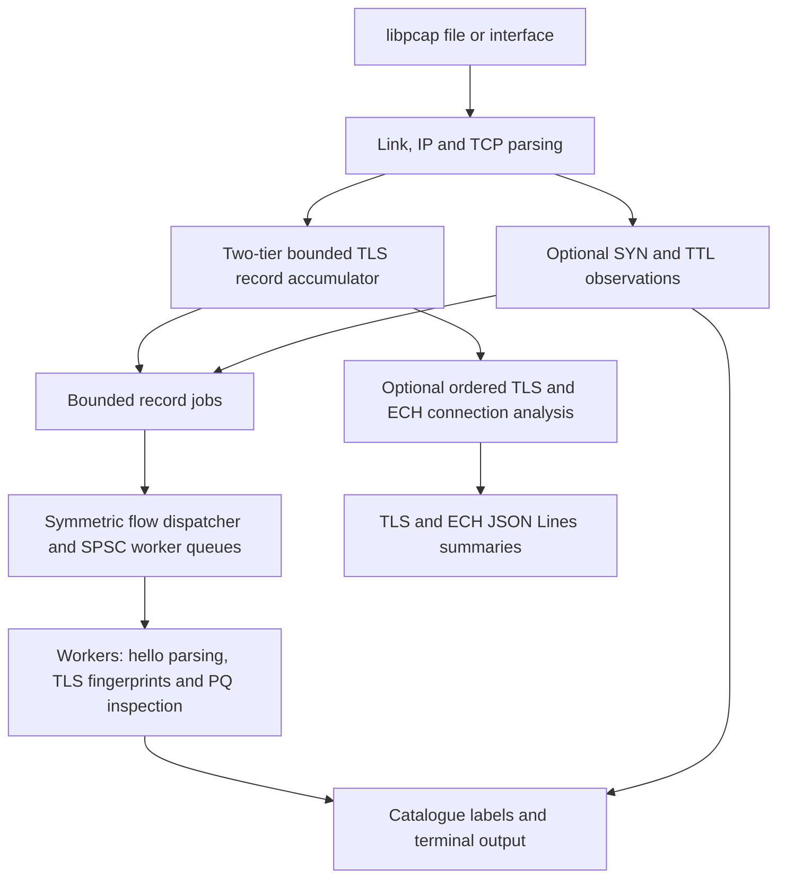

# Passive TLS and TCP Stack Fingerprinting with ECH and Post Quantum Metadata

**CS 331 Computer Networks — Phase 2 Project Report — Team T014**

Ujas Devang Shah (24110376); Satyakam Mishra (24110318); Pranjal Goyal (24110274); Harshal Kundanlal Rana (24110131); Divyansh Sharma (24110113); D A S K R Manognya (24110097).

## I. Introduction

Transport Layer Security (TLS) protects application payloads by providing confidentiality and integrity across untrusted networks. Its initial ClientHello and ServerHello messages nevertheless expose protocol metadata used to establish cryptographic parameters [6], [7]. Passive monitoring systems extract these visible attributes to compute TLS fingerprints, including JA3/JA3S and JA4/JA4S [11], [12], and compare them against a reference catalogue of client and server profiles. A fingerprint characterises the observed behaviour of a cryptographic stack or configuration; it does not prove the identity of an application or device.

Phase 1 established Python and single-threaded C++ fingerprinting pipelines and a reference catalogue. Phase 2 extends the C++ implementation into a modular TCP/TLS monitoring engine with bounded record accumulation, concurrent worker processing, transport-layer correlation through JA4T/JA4TS, Encrypted ClientHello (ECH) envelope decoding, and post-quantum (PQ) key-share inspection [1]. These extensions address practical observation challenges, including TCP segmentation, coalesced records, retransmissions, receive offloading, extension randomisation, and reduced visibility under ECH.

Evaluation combines known-answer tests, saved packet captures, synthetic transport controls, and endpoint-labelled ECH experiments. The results demonstrate supported record handling and workload-dependent replay throughput. They also establish two practical limits: the selected ECH envelope fields add no profile discrimination in the controlled corpus, and strict sequence-gap handling can prevent observation of a later hello.

## II. Problem Statement

Given packets from a live network interface or a PCAP/PCAPNG file, the engine must extract supported visible TLS handshakes, compute JA3/JA3S and JA4/JA4S signatures, and retrieve associated client or server tool and library labels from a known fingerprint catalogue. It must also support TCP stack observations through JA4T/JA4TS and optional ECH and PQ analysis. Inputs may contain records split across TCP segments, retransmissions, coalesced records, out-of-order arrivals, missing packets, or incomplete connections. Outputs comprise terminal fingerprints and catalogue labels, optional cross-layer alerts, verbose field inspection, and TLS/ECH JSON Lines summaries.

The core engineering challenge is to maintain bounded memory and useful processing throughput while preserving record boundaries and avoiding unsupported classifications. Capture requires access to the relevant traffic; observing both directions improves correlation, while missing SYNs or hellos reduces the available evidence. The implementation supports TLS over TCP. QUIC/UDP analysis and decryption of application traffic or the ECH inner ClientHello are outside its scope. Catalogue matching and transport consistency checks provide observational evidence rather than guarantees of application recognition, successful handshake completion, or attack detection.

## III. Project Objectives

1. **Standard TLS fingerprint generation.** Compute JA3/JA3S and JA4/JA4S with their respective GREASE filtering, field ordering and hashing rules, and verify representative known-answer vectors.
2. **Bounded TCP record accumulation.** Support complete records, TCP segmentation, retransmissions and coalesced records within explicit memory, timeout and sequence-handling limits.
3. **Cross-layer stack corroboration.** Generate JA4T/JA4TS from SYN/SYN-ACK metadata, correlate transport observations with TLS profiles, and evaluate honest, inconsistent and fully spoofed synthetic controls.
4. **ECH envelope inspection.** Decode visible ECH fields while keeping extension presence, parse status, anomalies and acceptance evidence separate.
5. **PQ key-share inspection.** Distinguish advertised hybrid groups from transmitted shares and inspect their framing, expected lengths and server selection.
6. **Reproducible performance evaluation.** Compare worker counts and tracking modes on identical saved workloads, recording configuration, packet and hello counts, timing ranges and input digests.

## IV. Architecture and Design

The engine adopts a pipelined architecture in which one capture thread performs packet ingestion, link/IP/TCP decoding and TLS record accumulation. Complete records are copied into bounded jobs and dispatched to workers through lock-free single-producer single-consumer (SPSC) queues. Each job carries the flow identity, record bytes and available SYN, time-to-live (TTL) and hello-role context. Workers parse hellos, compute fingerprints, maintain local PQ offer tables, and perform synchronised catalogue reporting [2].



*Figure 1. The capture thread owns record and ECH connection state; workers own their parsing and PQ correlation state. JSON summaries do not contain the terminal JA4T/PQ findings.*

Three design choices govern processing:

1. **Symmetric flow dispatch.** Both directions of a TCP connection map to the same worker, allowing client offers, HelloRetryRequest (HRR) messages and server selections to share a worker-local PQ table without cross-worker locking. Stateful ECH analysis remains ordered in the capture thread, which owns bidirectional connection generations, lifecycle tracking and JSON output.
2. **Two-tier record accumulation.** A complete record can borrow bytes directly from the current packet; an incomplete record uses allocated storage until its remaining bytes arrive. This reduces copying at record delivery, although queued worker jobs still copy their records. In stateful tracking, sequence watermarks suppress delivered retransmissions and partial overlaps retain only new suffix bytes. An unrecoverable gap after framing starts stops that direction to prevent desynchronisation.
3. **Bounded queues and worker draining.** Offline ingestion waits for space when a worker queue is full; live dispatch may drop jobs. At capture EOF or shutdown, workers drain queued jobs before processing returns. This preserves queued work without implying lossless live capture.

Split TLS record headers and multiple records within one TCP segment are supported. General out-of-order buffering and hellos spanning multiple TLS records are not. The central stateful accumulation procedure is:

```text
discard already-delivered prefix bytes; retain any new suffix
if a sequence gap breaks established framing:
    stop this direction and report incomplete transport
    return
read or complete the five-byte TLS record header
if total record size exceeds 8192 bytes:
    report unsupported input and stop this direction
    return
retain partial bytes until the record is complete
deliver the complete record
repeat for any remaining records in the segment
```

The 8,192-byte record limit includes the five-byte TLS header. Incomplete records have a three-second inactivity timeout. Stateful ECH tracking uses a default 30-second connection timeout and a capacity of 65,536 retained connections. These bounds trade general stream recovery for predictable resource use. Keeping connection state in one producer simplifies ownership, but introduces serial work and some repeated parsing between producer analysis and worker reporting.

## V. Implementation

The Phase 2 engine is implemented in C++17, using libpcap for acquisition, OpenSSL EVP for MD5 and SHA-256, and standard threads for worker execution. GoogleTest supplies most automated checks, with a standalone JA4T test runner. The engine loads a JSON fingerprint catalogue into memory and supports optional Redis connectivity, so basic catalogue lookup does not require an external database daemon. A match returns the labels stored against an observed signature rather than an independently verified application identity. Source code and tests are available in the project repository [1], [2].

### A. Cryptographic Fingerprint Generation

**JA3 and JA3S.** JA3 serialises five ClientHello fields in the following order [11]:

```text
legacy_version,cipher_suites,extension_types,supported_groups,ec_point_formats
```

Values are represented in decimal, lists are separated by hyphens, the five fields are separated by commas, and empty fields are retained. Reserved GREASE values are removed from the applicable 16-bit lists before MD5 hashing. GREASE deliberately exercises protocol extensibility [8]; the order of the remaining values is preserved. Consequently, extension permutation in modern clients can produce different JA3 hashes across connections. JA3S uses the server's legacy version, selected cipher suite and ordered non-GREASE extension list. MD5 provides compatibility with the fingerprint definition, not a security or identity guarantee.

**JA4 and JA4S.** JA4 contains a ten-character readable prefix and two 12-hex-digit SHA-256 prefixes [12]. The readable prefix encodes transport (`t` for TCP), the highest non-GREASE offered TLS version, SNI extension presence (`d` when present, `i` when absent), non-GREASE cipher and extension counts, and two characters derived from the first ALPN value. Version resolution uses `supported_versions` when available and otherwise the legacy hello version. The second component hashes sorted cipher IDs. The third hashes sorted extension IDs, excluding SNI (`0x0000`) and ALPN (`0x0010`), followed by wire-ordered signature algorithm IDs. Numeric IDs in these hash inputs use four-digit hexadecimal representation.

JA4S uses a server prefix, the selected cipher directly as a four-hex-digit middle component, and a hash of server extensions in wire order, including GREASE. HRR messages are recognised separately and excluded from ordinary server fingerprints. When ECH is present, client JA3/JA4 values describe the visible outer ClientHello [2].

### B. Transport and Cross-Layer Observations

JA4T and JA4TS summarise the TCP SYN and SYN-ACK respectively, using fields defined by TCP connection setup [10]. Their canonical form is:

```text
window_option-kinds_MSS_window-scale
```

Option kinds retain wire order, including MSS (`2`), SACK permitted (`4`), timestamps (`8`), NOP (`1`) and window scale (`3`). The engine supplements these signatures with TTL observations and estimates an initial TTL from common baselines of 64, 128 and 255. These values support coarse OS-family and hop estimates rather than definitive OS identification.

Cross-layer checks compare transport observations with OS-specific expectations in the catalogue and can emit `IMPERSONATION_MISMATCH`, `TTL_MISMATCH` and `STACK_ANOMALY`. An impersonation mismatch requires an `expected_os` entry; a generic Chrome signature alone does not establish Windows provenance. The TTL check tolerates a one-hop difference. Missing SYNs, proxies and copied TCP/IP headers limit these heuristics, so the synthetic testbed includes fully spoofed controls alongside honest and inconsistent profiles [3].

### C. ECH and Post Quantum TLS Inspection

**Encrypted ClientHello.** ECH protects a private inner ClientHello, including the intended server name, while leaving an outer ClientHello visible [9]. The parser decodes extension `0xfe0d` using nested length checks, extracting the variant, HPKE KDF and AEAD identifiers, configuration ID, encapsulation length and ciphertext length. Findings include duplicate ECH extensions, an inner marker in an outer hello, forbidden outer-extension references and inappropriate empty encapsulation. Unknown information remains explicitly unknown.

The engine separates structural observations from negotiation conclusions. TLS 1.3 alone does not prove ECH acceptance; a complete, consistent older-version negotiation can establish non-acceptance. Extension presence also does not reliably distinguish a real offer from GREASE. Positive acceptance labels in the controlled experiment come from separate endpoint records, while a complete hello pair establishes only successful parsing and connection correlation [4].

**Post-quantum key shares.** PQ inspection distinguishes capabilities advertised in `supported_groups` from shares actually transmitted in `key_share` [6]. Recognised groups include `0x11ec` (X25519MLKEM768), `0x11eb` (SecP256r1MLKEM768), `0x11ed` (SecP384r1MLKEM1024), and historical draft IDs `0x6399`/`0x639a`. For X25519MLKEM768, the expected client share is 1,216 bytes and the server share is 1,120 bytes. Malformed framing, incorrect recognised lengths and duplicate relevant extensions are flagged.

Worker-local offer tables correlate ClientHello offers with ServerHello selections across ordinary and HRR flows. Labels such as `HYBRID_SELECTED_OBSERVED` describe the selected group and observed share structure; they do not validate key contents or prove completed, quantum-secure key exchange. The tables are bounded but lack time-based or FIN/RST-driven expiry, limiting correlation for long-idle or reused tuples [5].

### D. Controls and Structured Output

`-r` selects a saved capture, `-i` selects live capture, and `-f` changes the default `tcp` BPF filter. `-j` sets worker count; otherwise, the engine uses reported hardware concurrency. `-t` enables JA4T/JA4TS and transport checks, `-v` enables verbose field inspection, and `-q` suppresses fingerprint presentation while retaining computation and benchmark statistics. `-c` adds a catalogue and `-u` enables interactive labelling.

Stateful ECH tracking is disabled by default and enabled with `-e`/`--ech`. `--json file` creates a new version 1 JSON Lines output and forces tracking on, even with `--no-ech`; existing output files are refused. PQ posture correlation and verbose checks are disabled by default and enabled with `-p`/`--pq`, while `--no-pq` explicitly disables them. Shared hello parsing still extracts PQ extension fields. JSON records contain TLS/ECH connection summaries and transport issues; JA4T alerts and PQ posture findings remain terminal outputs rather than a unified JSON record.

## VI. Testbed Setup

Builds, replays and timing trials reported here were performed on 6 November 2026 using a MacBook Air (Mac16,12) with an Apple M4 CPU, ten cores (four performance and six efficiency), 16 GB RAM and ARM64 macOS 27.0.1 build 26A434. The toolchain comprised AppleClang 21.0.0, CMake 4.4.5, OpenSSL 4.1.0, Apple libpcap 1.10.1, GoogleTest 1.14.0, Python 3.13.6 in the existing parent `.venv`, and TShark 4.6.8. Release used CMake's Release settings and the engine's `-O3`; Debug instrumented both the engine and GoogleTest with AddressSanitizer and UndefinedBehaviorSanitizer. No GPU was used.

| Workload or testbed | Configuration and role |
|---|---|
| `stress-distinct.pcap` | 20,000 TCP packets; 10,000 ClientHellos and 10,000 ServerHellos on distinct flows; synthetic throughput workload |
| `pq_ech_chrome.pcap` | 5,580 captured frames; the default TCP filter delivers 4,259 packets; segmentation, hybrid shares and HRR examples |
| `gro_on.pcap` and `gro_off.pcap` | Saved traces containing 5 and 100 packets respectively; comparison of visible client fingerprints across coalesced and segmented input |
| JA4T fixture | 19 synthetic scenarios and an explicit lab catalogue; offline cross-layer verdict checks |
| Controlled ECH experiment | IPv4 loopback; two profiles of pinned BoringSSL; endpoint logs, saved PCAPs and passive-engine records |

*Table I. Evaluation workloads and their roles.*

The ECH testbed pins BoringSSL revision `df870ed7fa51110edb872beb3357a44d20e1ce56`. Profile A offers TLS X25519 and Profile B offers P-256; both use ALPN `h2`, common cipher/signature settings, GREASE and extension permutation. They share one ECH configuration with X25519 HPKE, KDF 1, AEAD 1 and configuration ID 42. These ECH HPKE parameters are separate from the TLS key-exchange groups varied between profiles.

Each collection session contains ten fresh connections per profile, without resumption. Endpoint and passive records are joined by session, oriented connection tuple and outer ClientHello random. The original collection used engine `dd3860a` on the same MacBook Air. Its original tool versions remain in the build manifest; the present evaluation replays and analyses those saved artifacts [4].

## VII. Evaluation

### A. Verification Suite and Transport Replay

| Verification | Result | Interpretation |
|---|---|---|
| Release CTest | 189/189 pass | Includes catalogue lookup regression across four working directories |
| ASan/UBSan Debug CTest | 189/189 pass | No sanitiser findings reported in the recorded run |
| ECH lab checks | 17/17 pass | Join rules, evidence boundaries and runner behaviour |
| Freshly generated JA4T scenarios | 19/19 expected verdicts | Honest controls, missing SYNs and fully copied headers |
| Twelve selected captures | Ordered JSON matches across Release 1/2/4 workers and Debug 4 workers | Capture ID and relocated source path normalised before comparison |

*Table II. Automated verification and selected replay results.*

The suite covers Salesforce JA3 and FoxIO JA4/JA4S known-answer vectors, SPSC queues, malformed inputs, segmented/coalesced records, lifecycle handling, ECH decoding, PQ offer correlation and synthetic large-record boundaries [2]. These results validate the exercised cases rather than complete protocol compliance or recognition accuracy. The available community hash mappings do not provide a reproducible audit trail for full JA3/JA3S validation against the community dataset.

The GRO-on and GRO-off captures produce the same unique client JA3, `284deaeae14ea5ddc96c5d7e59855422`, and JA4, `t13d301200_1d37bd780c83_ecd0401ec68b`. Their packet and connection counts differ, so this establishes agreement of the selected features rather than whole-capture equality. Synthetic large-record boundary checks also pass; the reported rerun does not establish actual hardware-LRO invariance.

With stateful ECH tracking disabled, the PQ capture yields 22 ClientHellos, 19 ordinary ServerHellos and three HRRs. Thirteen client hellos contain 1,216-byte `0x11ec` shares, and eight server hellos select 1,120-byte hybrid shares. All 44 inspected hellos, including HRRs, report PQ wire checks as `ok`. Enabling ECH tracking reduces the ordinary ServerHello count to 18: frame 26 arrives ahead of missing sequence bytes after HRR, causing the tracker to stop that direction before the later ServerHello at frame 29. TShark's out-of-order reconstruction exposes the missed hello. This is a concrete reordering limit and creates unequal server work between tracking modes.

### B. Controlled ECH Profile Discrimination

The controlled corpus contains 60 endpoint-confirmed accepted TLS 1.3 connections across three sessions, with zero exclusions. A separate three-attempt pilot contains accepted Profile A, accepted Profile B and an explicit GREASE control. Recomputing the saved analysis and replaying all four PCAPs reproduce the endpoint joins and grouping results without modifying the original evidence [4].

| Feature set on the 60 accepted connections | Distinct groups | Groups shared by A and B |
|---|---:|---:|
| Outer JA3 | 60 | 0 |
| Outer JA3 plus selected ECH fields | 60 | 0 |
| Outer JA4 | 1 | 1 |
| Outer JA4 plus selected ECH fields | 1 | 1 |

*Table III. Fingerprint grouping across the accepted ECH corpus.*

The additional fields are KDF ID, AEAD ID, encapsulation length and ciphertext length. Every accepted offer has the tuple `(1, 1, 32, 176)`, so these fields add no discrimination between the selected profiles. All 60 outer JA3 values differ with extension permutation enabled, providing variation without repeatable profile identification. Both profiles share outer JA4 `t13d0308h2_55b375c5d22e_0365bc7f0f41`. TShark pilot checks agree after removing GREASE signature IDs from its raw JA4 input, a documented tool discrepancy.

The result demonstrates no incremental discrimination from the selected ECH fields in this corpus. It concerns two configurations of one TLS library, rather than independent browser families or arbitrary applications. No matched ECH-on/ECH-off connection study or TLS handshake-latency experiment was conducted. Section VII.C instead measures offline analyser throughput.

### C. Throughput and Worker Scalability

The Release engine was benchmarked with one, two and four workers, with stateful ECH tracking disabled and enabled. Every configuration explicitly enabled `--pq`; worker counts exclude the capture thread. Each configuration received one warm-up and seven measured runs, with execution order rotated between rounds. Table IV reports median and minimum–maximum throughput in thousands of packets per second (kpps), measured over the engine's internal capture/processing interval through worker draining. No builds or other verification ran during timing.

| Capture | Workers | ECH tracking | Median kpps | Range kpps |
|---|---:|---|---:|---:|
| Distinct-flow stress | 1 | Off | 254.6 | 209.4–298.1 |
| Distinct-flow stress | 1 | On | 229.6 | 204.9–302.7 |
| Distinct-flow stress | 2 | Off | 488.2 | 379.9–533.1 |
| Distinct-flow stress | 2 | On | 220.9 | 185.9–288.0 |
| Distinct-flow stress | 4 | Off | 609.5 | 318.6–826.9 |
| Distinct-flow stress | 4 | On | 160.8 | 46.4–208.4 |
| PQ/ECH Chrome | 1 | Off | 1,807.7 | 1,469.1–1,846.9 |
| PQ/ECH Chrome | 1 | On | 1,600.5 | 1,490.2–1,670.2 |
| PQ/ECH Chrome | 2 | Off | 1,801.6 | 1,399.6–1,870.4 |
| PQ/ECH Chrome | 2 | On | 1,572.7 | 1,394.6–1,633.1 |
| PQ/ECH Chrome | 4 | Off | 1,771.6 | 541.8–1,903.0 |
| PQ/ECH Chrome | 4 | On | 1,353.8 | 1,274.8–1,551.5 |

*Table IV. Warm-cache offline replay throughput with PQ posture analysis enabled.*

All stress runs process the same 20,000 packets and 10,000 hellos per direction. With ECH tracking off, median throughput rises from 254.6 to 609.5 kpps between one and four workers, approximately a 2.39-fold increase. With tracking on, medians do not improve as workers are added. The broad ranges and short trials do not isolate a bottleneck or establish a statistically significant scaling effect. The PQ capture has very short processing intervals and unequal server work between tracking modes, so its rows describe timings rather than a feature-overhead ratio.

Quiet mode retains TLS hashing and explicitly enabled PQ posture work, while excluding catalogue presentation, verbose transport alerts and JSON output. Toggling ECH tracking changes analyser behaviour, not ECH negotiation in the recorded connections. These warm-cache offline measurements establish neither live line-rate performance nor long-run capacity. Earlier timing batches were not pooled with this evaluation.

## VIII. Summary and Limitations

Phase 2 extends the original fingerprinting pipeline into a concurrent TCP/TLS monitor combining bounded record handling, catalogue lookup, transport consistency checks, ECH envelope observations and PQ share inspection. The recorded verification passes across Release and sanitised Debug builds. The controlled ECH experiment demonstrates fingerprint computation on confirmed accepted connections while showing no added discrimination from the selected envelope fields. Offline benchmarks show workload-dependent worker gains: additional workers improve the distinct-flow stress median with ECH tracking off, while tracking-enabled medians show no corresponding gain.

The principal limitations follow from passive visibility and bounded state. Outer metadata cannot prove application identity or reliably separate real from GREASE ECH; PQ length checks cannot validate cryptographic key contents. Strict sequence-gap handling can miss later hellos, cross-record hellos remain unsupported, and worker-local PQ offer tables lack time and FIN/RST expiry. Future work includes bounded reordering and cross-record support, improved PQ lifecycle management, unified JA4T/PQ JSON telemetry, longer controlled benchmarks, and independently labelled client families. QUIC support and hardware-LRO validation remain separate work.

## IX. Reproducibility

The repository is [TLS-Fingerprinting](https://github.com/Ujas-PersistentCoder/TLS-Fingerprinting). The reported evaluation describes the post-restructure tree based on `2f4a78b`, including the verified path fixes; source and binary digests identify the measured build [1]. Run commands from the repository root using a C++17 compiler, CMake, libpcap and OpenSSL. CMake obtains GoogleTest 1.14.0; the sanitised configuration instruments GoogleTest alongside the engine. TShark is required for ECH evidence checks, and Python commands use an existing virtual environment.

### A. Build and Automated Checks

```sh
export PYTHON="$PWD/../.venv/bin/python"

cmake -S 'Phase 2/code/engine' -B build/phase2 -DCMAKE_BUILD_TYPE=Release
cmake --build build/phase2 -j 4
ctest --test-dir build/phase2 --output-on-failure

cmake -S 'Phase 2/code/engine' -B build/phase2-debug -DCMAKE_BUILD_TYPE=Debug
cmake --build build/phase2-debug -j 4
ctest --test-dir build/phase2-debug --output-on-failure

"$PYTHON" -m pytest 'Phase 1/code/python/tests' -q
"$PYTHON" -m unittest discover -s 'Phase 2/code/experiments/ech' -p test_lab.py -v
"$PYTHON" 'Phase 2/code/testbed/ja4t_lab.py' \
  --out build/ja4t-lab --engine build/phase2/tlsfp_phase2
```

The `PYTHON` path above matches this workspace's parent `.venv`; adapt it to an existing environment containing the testbed dependencies. Rebuild after moving the checkout because CMake caches contain absolute source paths. Catalogue lookup falls back to CMake-recorded shared `Phase 1/code/` data and diagnoses missing files or an empty load. Quiet-mode timing alone does not verify catalogue loading.

### B. Packet Replay and ECH Analysis

```sh
build/phase2/tlsfp_phase2 -r 'Phase 2/code/pcaps/gro_off.pcap' -v
build/phase2/tlsfp_phase2 -r 'Phase 2/code/pcaps/gro_on.pcap' -v
build/phase2/tlsfp_phase2 -r 'Phase 2/code/pcaps/pq_ech_chrome.pcap' -v -t --pq --ech
build/phase2/tlsfp_phase2 -r 'Phase 2/code/pcaps/pq_ech_chrome.pcap' \
  -q -j 2 --pq --json /tmp/tlsfp-pq-new.jsonl

"$PYTHON" 'Phase 2/code/experiments/ech/run.py' replay \
  --engine build/phase2/tlsfp_phase2 \
  --source 'Phase 2/code/experiments/ech/results/corpus' --out /tmp/ech-replay-new

"$PYTHON" 'Phase 2/code/experiments/ech/run.py' report \
  --pilot 'Phase 2/code/experiments/ech/results/pilot' \
  --collection 'Phase 2/code/experiments/ech/results/corpus' --out /tmp/ech-report-new
```

Use new JSON filenames and output directories. The ECH `report` command recomputes the original saved analysis; `replay` separately records results from the selected engine. Endpoint joins for the reported rerun were checked using copies of the original logs. Offline analysis needs no private keys and preserves the original corpus. Fresh collection additionally requires loopback capture permission and the pinned endpoint dependencies documented in the lab README.

### C. Throughput Measurements

```sh
"$PYTHON" 'Phase 2/code/testbed/benchmark_modes.py' \
  --engine build/phase2/tlsfp_phase2 --out build/benchmark-phase2-new
```

The benchmark runner enables `--pq`, compares workers 1/2/4 with ECH tracking off/on, and executes one warm-up plus seven rotating measured rounds for each configuration. Across both workloads it records all 96 executions, configuration metadata, source/binary/workload digests, packet and hello counts, and summary statistics. Existing output directories are refused and unequal work is flagged. The workload SHA-256 digests are:

```text
Phase 2/code/pcaps/stress-distinct.pcap
aef1ef7c468c6869c973e6c53e7de0200692e2928dec0966896a5b56ee770d20

Phase 2/code/pcaps/pq_ech_chrome.pcap
40ac4723bf2044cffab3666d00fd48f1499d253cad6cecb9a34b0a3644e3d792
```

## References

[1] Team T014, “TLS Fingerprinting,” project repository, 2026. Evaluated post-restructure base revision `2f4a78bbf49b4b8e91ca919ecad86b9b79aa7ff1`, with path fixes identified by the recorded source and binary digests. [Repository snapshot](https://github.com/Ujas-PersistentCoder/TLS-Fingerprinting/tree/2f4a78bbf49b4b8e91ca919ecad86b9b79aa7ff1).

[2] Team T014, “Phase 2 engine implementation and tests,” 2026. [Source, headers, build configuration and tests](https://github.com/Ujas-PersistentCoder/TLS-Fingerprinting/tree/2f4a78bbf49b4b8e91ca919ecad86b9b79aa7ff1/Phase%202/code/engine), including capture, accumulator, parser, fingerprint, catalogue, ECH and PQ modules.

[3] Team T014, “JA4T and cross-layer spoofing lab,” 2026. [Implementation notes](https://github.com/Ujas-PersistentCoder/TLS-Fingerprinting/blob/2f4a78bbf49b4b8e91ca919ecad86b9b79aa7ff1/Phase%202/code/engine/JA4T.md) and [testbed with saved fixtures](https://github.com/Ujas-PersistentCoder/TLS-Fingerprinting/tree/2f4a78bbf49b4b8e91ca919ecad86b9b79aa7ff1/Phase%202/code/testbed).

[4] Team T014, “Reduced ECH checkpoint 3 experiment,” 2026. [Method, endpoint implementation, analysis and public evidence](https://github.com/Ujas-PersistentCoder/TLS-Fingerprinting/tree/2f4a78bbf49b4b8e91ca919ecad86b9b79aa7ff1/Phase%202/code/experiments/ech). Original collection engine `dd3860a`; pinned BoringSSL revision retained in the manifests.

[5] Team T014, “PQ-TLS checkpoint 2,” 2026. [Checkpoint evidence and limitations](https://github.com/Ujas-PersistentCoder/TLS-Fingerprinting/blob/2f4a78bbf49b4b8e91ca919ecad86b9b79aa7ff1/Phase%202/report/docs/PQTLS_Checkpoint_2_Testing.md), with current parser, analysis and tests in [2]. Historical checkpoint counts are distinct from the evaluation reported here.

[6] E. Rescorla, “The Transport Layer Security (TLS) Protocol Version 1.3,” RFC 8446, August 2018. [doi:10.17487/RFC8446](https://www.rfc-editor.org/rfc/rfc8446.html). Sections 4.1, 4.2.7–4.2.8 and 5.

[7] T. Dierks and E. Rescorla, “The Transport Layer Security (TLS) Protocol Version 1.2,” RFC 5246, August 2008. [doi:10.17487/RFC5246](https://www.rfc-editor.org/rfc/rfc5246.html). Sections 6.2 and 7.4.1.

[8] D. Benjamin, “Applying Generate Random Extensions And Sustain Extensibility (GREASE) to TLS Extensibility,” RFC 8701, January 2020. [doi:10.17487/RFC8701](https://www.rfc-editor.org/rfc/rfc8701.html).

[9] E. Rescorla, K. Oku, N. Sullivan and C. A. Wood, “TLS Encrypted Client Hello,” RFC 9849, March 2026. [doi:10.17487/RFC9849](https://www.rfc-editor.org/rfc/rfc9849.html). Sections 3.2, 5 and 6.1.4.

[10] W. Eddy, Ed., “Transmission Control Protocol (TCP),” RFC 9293, August 2022. [doi:10.17487/RFC9293](https://www.rfc-editor.org/rfc/rfc9293.html). Sections 3.1–3.5.

[11] Salesforce, “JA3 — A method for profiling SSL/TLS Clients.” [Reference repository and fingerprint definition](https://github.com/salesforce/ja3).

[12] FoxIO, “JA4+ Network Fingerprinting.” [Reference repository](https://github.com/FoxIO-LLC/ja4) and [JA4 technical specification](https://github.com/FoxIO-LLC/ja4/blob/main/technical_details/JA4.md).

## Appendix A Team Work Distribution and Member Rating

| No. | Member name | Roll number | Tasks done | Rating out of 10 |
|---:|---|---|---|---:|
| 1 | Ujas Devang Shah | 24110376 | High-speed C++ engine architectural redesign; implemented the two-tier TCP stream accumulator (fast path & segment reassembly), end-to-end integration, and codebase-wide technical review. | 10 |
| 2 | Satyakam Mishra | 24110318 | Concurrent pipeline engineering (lock-free worker ring buffers, symmetric 4-tuple flow dispatch, worker draining); GRO/LRO transport offload invariance testing and validation. | 8 |
| 3 | Pranjal Goyal | 24110274 | Encrypted ClientHello (ECH, ext 0xfe0d) parser implementation; HPKE parameter decoding (KDF/AEAD, config ID, key shares), stateful connection tracking, and outer envelope analysis. | 9 |
| 4 | Harshal Kundanlal Rana | 24110131 | JA4T/JA4TS testbed design; created synthetic cross-layer spoofing test fixtures, conducted packet capture validation, and performed transport fingerprint code review. | 7 |
| 5 | Divyansh Sharma | 24110113 | JA4T/JA4TS transport-layer fingerprinting vertical; implemented TCP SYN/SYN-ACK options extraction (Window, MSS, Scale, layout), initial TTL hop estimation, and OS stack inference. | 5 |
| 6 | D A S K R Manognya | 24110097 | Post-Quantum (PQ) TLS inspection vertical; developed ML-KEM hybrid key-share verification (X25519MLKEM768 1,216B/1,120B length validation), HRR tracking, and worker offer tables. | 6 |

## Appendix B AI Usage Details

| No. | AI tool and model | Purpose and architectural scope |
|---:|---|---|
| 1 | Antigravity AI (Google) | High-speed C++ engine redesign: SPSC lock-free queues, symmetric hashing dispatcher, and thread draining. |
| 2 | Gemini 3.5 Flash model (Google) | Stream accumulator refactoring: Tier-1 fast path vs. Tier-2 reassembly, GRO/LRO invariance verification. |
| 3 | Codex (OpenAI) | Modern extension development: ECH envelope length decoding. |
| 4 | Claude | JA4T implementation. |
| 5 | Claude | Post-Quantum X25519MLKEM768 key share validation. |

### B.1 Prompts

[AUTHOR TO FILL: add significant prompts or chat-log links for the Phase 2 uses listed above, with the relevant prompt/response Markdown files shared in the repository.]
