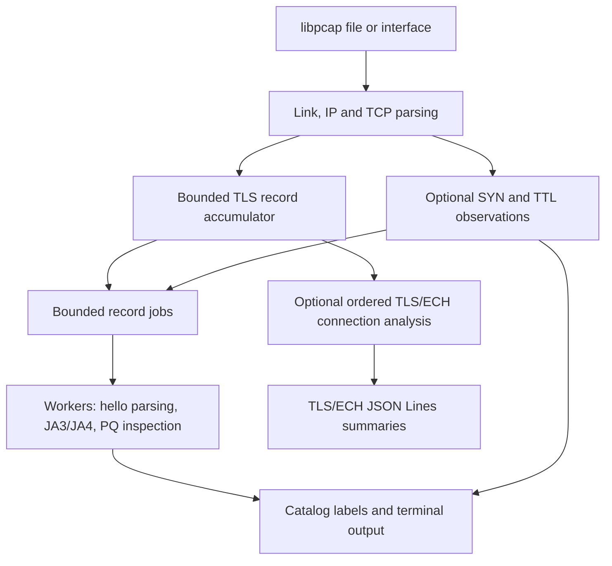

<!--
AUTHOR REVIEW — not part of the final Word report
Status: initial working draft; content has NOT been approved.
Source baseline: main, 1254a3f8c164ba0ffec3e3d265cc5536af5320dc.
Fresh verification date: 6 November 2026, Asia/Kolkata.
Only this Markdown file is being authored. Do not generate or modify report.docx.
The template's skipped IV and duplicated IX have been corrected without dropping sections.
Target: about five body pages; below eight where practical; maximum ten. References and
appendices are excluded by the template. Actual pagination awaits separately authorized Word work.

OPEN ITEMS
1. Author will manually fill the six contribution rows and six distinct, team-agreed ratings.
2. Author will manually fill the AI tool/purpose table and significant prompt/chat-log links.
3. Confirm the original ECH collection host's CPU, RAM and OS. Current-machine specifications
   describe fresh replay/benchmarking only; they are not substituted for historical hardware.
4. Is there an original JA3/JA3S ja3er.com validation record with inputs, outputs and provenance?
   code/reference/expected_hashes.csv has three client mappings; validation_notes.md is empty.
   This draft does not claim that the community-validation gate was demonstrated.
5. Review the reported PQ-capture mode difference and hardware-LRO evidence boundary.
   Source fixes or additional live experiments require a separate task; none were made here.
6. Confirm the provisional title, technical content and final page budget before approving content.

EVIDENCE NOTES
- Charter/roadmap intentions do not establish implemented features. In particular, there is no
  unified JSON record containing JA4T and PQ posture in this revision; QUIC remains unsupported.
- Historical test counts (76/123/139 for ECH stages; 63/83/96 for PQ stages) refer to earlier
  trees and are not current-main results. Current CTest has 187 GoogleTest cases plus one
  standalone JA4T entry, all passing in both configurations.
- The older Python/C++ comparison has unequal packet counts, and stress_test.pcap has unequal
  hello counts. Neither supplies a fair current-engine speedup claim.
- LRO_Findings.md makes broader claims than the available hardware evidence supports. Current
  LRO boundary checks are synthetic; no fresh hardware LRO or live capture was performed.
- The original ECH collection used engine dd3860a00c7c9096ba18d1612017ca748e29c6ff.
  Original JSON is preserved. Current replay reproduces joins/grouping; do not claim full JSON
  equality to that older engine, since server JA4S wire-order handling changed at integration.
- Benchmarking used the unmodified CLI. Verbose/JA4T checks used the same Release static
  CaptureEngine library through a temporary driver, with Redis port 0 to avoid catalog writes.
  JA4T checks called the tracked testbed's verify() on the tracked PCAP/catalog, without generation.
  Fresh Scapy PCAP generation attempted neighbor resolution and failed on unavailable BPF access;
  this does not invalidate replay of the tracked synthetic fixture. No live scenario was generated.
- The complete fresh evidence and temporary runners are in
  /private/tmp/cs331-final-report-1254a3f/; durable benchmark values are retained below.
-->

# Passive TLS Fingerprinting with Transport ECH and Post Quantum Metadata

**CS 331 Computer Networks — Team T014 — Phase 2**

Ujas Devang Shah (24110376); Satyakam Mishra (24110318); Pranjal Goyal (24110274); Harshal Kundanlal Rana (24110131); Divyansh Sharma (24110113); D A S K R Manognya (24110097).

## I. Introduction

TLS encrypts application data, but its initial handshake exposes some protocol choices. A passive observer can extract these choices from ClientHello and ServerHello messages and summarize them as fingerprints. A fingerprint describes visible behavior shared by a TLS stack or configuration; it does not prove the identity of an application or device.

Phase 1 provided Python and C++ fingerprinting implementations and a reference catalog. Phase 2 develops the C++ engine into a modular TCP/TLS monitor with worker threads, bounded record accumulation, transport fingerprints, Encrypted ClientHello (ECH) observations, and post-quantum (PQ) key-share inspection [1]. Our evaluation combines known-answer tests, saved traffic, synthetic controls, and endpoint-labeled ECH experiments. It also exposes limits: ECH fields add no profile discrimination in the supplied controlled corpus, and stateful tracking can miss a later hello after a sequence gap.

## II. Problem Statement

Given packets from a live interface or a PCAP/PCAPNG file, extract supported visible TLS hellos, compute JA3/JA3S and JA4/JA4S, and report additional transport and key-exchange observations. Inputs may contain segmented records, retransmissions, coalesced records, missing packets, or incomplete connections. Outputs are terminal fingerprints and catalog labels, optional TCP-based alerts, verbose inspection, and optional TLS/ECH JSON Lines summaries.

The engineering problem is to connect packet-level explanations with bounded processing and honest uncertainty. The project extends its earlier fingerprint-only pipeline; it does not establish a general weakness in existing monitoring products. Capture requires access to the relevant traffic. Both directions improve correlation, while missing SYNs or hellos reduce the available evidence. The engine supports TCP rather than QUIC/UDP, does not decrypt ECH or application traffic, and does not guarantee application recognition, successful TLS completion, or attack detection.

## III. Project Objectives

1. Compute the four TLS fingerprints and check representative known-answer vectors.
2. Handle complete records and supported TCP segmentation with explicit size and state limits.
3. Correlate SYN/SYN-ACK metadata with hellos and exercise honest, inconsistent, and fully spoofed synthetic controls.
4. Extract ECH envelope fields while separating presence, parse status, findings, and acceptance evidence.
5. Inspect advertised PQ groups and key-share sizes without claiming cryptographic verification.
6. Evaluate current engine modes on identical captures with recorded settings and reproducible counts.

## IV. Architecture and Design



*Figure 1. Capture-thread state is separate from worker reporting. The JSON branch does not include the terminal JA4T/PQ findings.*

The capture thread parses link, IP and TCP headers and owns record accumulation. With ECH tracking enabled, it also owns bidirectional connection generations, lifecycle state, and JSON output. Each complete record sent to a worker is copied into a bounded job, including any captured SYN and TTL context. A symmetric flow hash sends both directions to the same worker. Workers have separate parser scratchpads and PQ offer tables, and terminal output is synchronized [2].

The accumulator can borrow bytes for a complete record and allocate storage for an unfinished one. This reduces copying at record delivery, but worker jobs still copy records: the whole pipeline is not zero-copy. In stateful tracking, sequence watermarks suppress delivered retransmissions; partial overlaps retain only the new suffix. A gap after framing starts stops that direction. There is no general out-of-order queue. Split record headers and multiple records in one segment are supported; a hello spanning multiple TLS records is not. The central stateful rule is:

```text
discard already-delivered prefix bytes; keep any new suffix
if a gap breaks established framing: stop this direction
read or complete the five-byte TLS record header
if total record size exceeds 8192: report unsupported input
retain partial bytes until complete; then deliver the record
repeat for any remaining records in the segment
```

An assembled record is limited to 8,192 bytes including its five-byte header. Incomplete-record timeout is three seconds; default ECH connection timeout is 30 seconds, with at most 65,536 retained connections. These are implementation limits, not TLS protocol guarantees. Bounded worker queues make offline capture wait when full; live dispatch may drop jobs. Ordered producer state simplifies ownership at the cost of serial work and some repeated parsing. Consumer threads drain before capture returns.

## V. Implementation

The engine uses C++17, libpcap for capture, OpenSSL EVP for hashing, and standard threads. GoogleTest supplies most tests; JA4T also has a standalone test runner. Redis is optional: the engine can load the tracked JSON catalog into memory. Catalog matches are labels associated with observed fingerprints, not independently verified identities. The repository is [TLS-Fingerprinting](https://github.com/Ujas-PersistentCoder/TLS-Fingerprinting), and this report evaluates commit `1254a3f` [1].

### A. TLS fingerprints

JA3 serializes five ClientHello fields:

```text
legacy_version,cipher_suites,extension_types,supported_groups,ec_point_formats
```

Numeric values are written in decimal; list values are separated by hyphens, empty fields are retained, and MD5 produces the final hash. Reserved GREASE values are filtered from the applicable 16-bit fields. GREASE deliberately exercises protocol extensibility. The remaining list order is preserved, so browser extension permutation can change JA3. JA3S uses the server's legacy version, selected cipher, and ordered non-GREASE extensions. MD5 is required for compatibility here; it supplies no identity or security proof.

JA4 combines a readable prefix with two 12-hex-digit SHA-256 prefixes. The prefix encodes TCP, the highest non-GREASE offered version, server name indication (SNI) extension presence, cipher and extension counts, and two characters derived from the first application-layer protocol negotiation (ALPN) value. Cipher IDs and selected extension IDs are sorted for hashing; SNI and ALPN are excluded from the extension hash, while signature algorithms retain wire order. JA4S uses the selected cipher and hashes server extensions in wire order, including GREASE. HelloRetryRequest (HRR) is recognized separately and excluded from ordinary server fingerprints. With ECH, the client fingerprints describe the visible outer hello [2].

### B. Transport and modern TLS observations

| Capability | Implemented behavior | Evidence limit |
|---|---|---|
| JA4T / JA4TS | SYN / SYN-ACK window, option order, MSS and window scale | Requires a captured, correlated SYN |
| Transport alerts | Compare expected OS, inferred stack and packet TTL | Heuristics; matching metadata can be spoofed |
| ECH | Decode variant, KDF/AEAD IDs, config ID and lengths | Does not recover the inner hello or prove acceptance |
| PQ inspection | Read group IDs, share lengths and server selection | Does not validate key contents or completed key exchange |
| JSON Lines | Version 1 TLS/ECH connection summaries and transport issues | No unified JA4T/PQ posture record |

JA4T has the form `window_option-kinds_MSS_window-scale`; TTL is used alongside it. The engine can report `IMPERSONATION_MISMATCH`, `TTL_MISMATCH`, and `STACK_ANOMALY`. An impersonation mismatch requires an OS-specific `expected_os` catalog entry. A generic Chrome fingerprint does not establish Windows identity. The TTL check tolerates a one-hop difference. Proxies and crafted TCP/IP headers further limit interpretation [3].

ECH encrypts a private inner ClientHello, including the intended server name, while leaving an outer hello visible. Extension `0xfe0d` is decoded with nested length checks. Findings include duplicates, an external inner marker, forbidden outer-extension references, and inappropriate empty encapsulation. Missing information remains unknown. TLS 1.3 alone does not establish acceptance; a completely observed older negotiation can establish non-acceptance. Positive ECH acceptance in our experiment comes from separate endpoint logs. A complete hello pair is only a parsing/correlation result [4].

PQ inspection distinguishes advertised capabilities in `supported_groups` from the bytes actually offered in `key_share`. It recognizes hybrid groups `0x11ec`, `0x11eb`, `0x11ed` and historical draft IDs `0x6399`/`0x639a`. For example, the engine checks X25519MLKEM768 shares against 1,216 client bytes and 1,120 server bytes. Malformed framing, wrong recognized lengths, and duplicate relevant extensions are flagged. Worker-local offer tables correlate client offers with server choices; their size is bounded, but they have no time or FIN/RST expiry. Reported hybrid selection is a wire observation, not proof of quantum security [5].

### C. Controls and output

`-r` selects a saved capture; `-i` selects live capture; `-f` changes the default `tcp` BPF filter. `-j` sets workers, otherwise the engine uses reported hardware concurrency. `-t` enables JA4T/JA4TS and transport checks; `-v` adds dissection; `-q` suppresses presentation while retaining fingerprint computation. `-c` adds a catalog, and `-u` allows interactive labeling. Stateful ECH analysis is off by default and enabled by `-e`/`--ech`. `--json file` creates a new JSON Lines file and forces ECH tracking on, even with `--no-ech`. Existing output files are refused. PQ observations are presented in verbose terminal output; there is no separate PQ CLI switch.

## VI. Testbed Setup

Fresh builds, replays and timing trials were performed on 6 November 2026. They used a MacBook Air (Mac16,12), Apple M4 with ten cores (four performance and six efficiency), 16 GB RAM, ARM64, and macOS 27.0.1 build 26A434. The tools were AppleClang 21.0.0, CMake 4.4.5, OpenSSL 4.1.0, Apple libpcap 1.10.1, GoogleTest 1.14.0, Python 3.13.6 in the existing parent `.venv`, and TShark 4.6.8. Release used CMake's Release settings plus the engine's `-O3`; Debug instrumented the engine and GoogleTest with AddressSanitizer and UndefinedBehaviorSanitizer. No GPU was used.

| Workload or testbed | Configuration and role |
|---|---|
| Distinct-flow stress capture | 20,000 TCP packets; 10,000 ClientHellos and 10,000 ServerHellos; synthetic throughput workload |
| Saved PQ/ECH Chrome capture | 5,580 frames; default TCP filter delivers 4,259 packets; segmented, hybrid and HRR examples |
| JA4T fixture | 19 synthetic scenarios plus an explicit lab catalog; offline verdict checks |
| Original ECH experiment | IPv4 loopback; two profiles of pinned BoringSSL; endpoint logs and saved PCAPs; current work replays these artifacts |

The ECH dependency revision is `df870ed7fa51110edb872beb3357a44d20e1ce56`. Profile A offers TLS X25519 and B offers P-256; both use ALPN `h2`, common cipher/signature settings, GREASE and extension permutation. They share one ECH configuration using X25519 HPKE, KDF 1, AEAD 1 and config ID 42. Each session contains ten connections per profile, with fresh clients and no resumption. Endpoint records are joined to passive records using session, oriented tuple, and outer random. The original capture used engine `dd3860a`; **[AUTHOR TO FILL: original ECH collection host CPU, RAM and OS]**. Its recorded compiler, CMake and TShark versions are retained in the build manifest [4].

## VII. Evaluation

### A. Tests and replay

| Fresh check on current main | Result | Interpretation |
|---|---|---|
| Release CTest | 188/188 pass | 187 GoogleTest cases and one standalone JA4T entry |
| ASan/UBSan Debug CTest | 188/188 pass | No sanitizer findings reported in this run |
| ECH lab checks | 15/15 pass | Join rules, evidence boundaries and runner behavior |
| Saved JA4T scenarios | 19/19 expected verdicts | Includes honest controls, missing SYNs and fully copied headers |
| Twelve selected captures | Ordered JSON matches across Release 1/4 workers and Debug 4 workers | Generated capture ID removed before comparison |

The tests include Salesforce JA3 known-answer vectors, FoxIO JA4/JA4S vectors, malformed inputs, segmented/coalesced records, lifecycle handling and synthetic large-record boundaries [2]. Passing them does not establish complete protocol compliance or recognition accuracy. The available community hash mappings do not provide a reproducible audit trail for full JA3/JA3S community-dataset validation.

Replaying the GRO-on and GRO-off captures yields the same unique client JA3 (`284deaeae14ea5ddc96c5d7e59855422`) and JA4 (`t13d301200_1d37bd780c83_ecd0401ec68b`). Their packet and connection counts differ, so this is a feature comparison, not whole-capture equality. Synthetic LRO-sized record tests pass; actual hardware-LRO invariance has not been demonstrated by this rerun.

In default ECH-off mode, the PQ capture produces 22 ClientHellos, 19 ordinary ServerHellos and three HRRs. Thirteen client hellos contain 1,216-byte `0x11ec` shares; eight server hellos select 1,120-byte hybrid shares. All 44 inspected hellos, including HRRs, report PQ wire checks as `ok`. With ECH tracking enabled, only 18 ordinary ServerHellos are counted. On the affected connection, frame 26 arrives ahead of missing sequence bytes after HRR; tracking reports a gap and does not process the later ServerHello at frame 29. TShark's out-of-order reassembly exposes that hello. This illustrates the engine's reordering limit and prevents an equal-work speed comparison between these modes on this capture.

### B. Controlled ECH result

The original corpus contains 60 endpoint-confirmed accepted connections across three sessions, with zero exclusions. A separate three-attempt pilot contains accepted A, accepted B, and an explicit GREASE control. Recomputing the original analysis and replaying all four PCAPs through current main reproduce the joins and grouping results. Original evidence files were preserved [4].

| Feature set on the 60 accepted connections | Distinct groups | Groups shared by A and B |
|---|---:|---:|
| Outer JA3 | 60 | 0 |
| JA3 plus selected ECH fields | 60 | 0 |
| Outer JA4 | 1 | 1 |
| JA4 plus selected ECH fields | 1 | 1 |

The added fields are KDF ID, AEAD ID, encapsulation length and ciphertext length. Every accepted offer has values `(1, 1, 32, 176)`, so they add no discrimination here. All JA3 values differ with permutation enabled; this is variation without repeatable profile identification. Both profiles share JA4 `t13d0308h2_55b375c5d22e_0365bc7f0f41`. TShark pilot checks agree after removing GREASE signature IDs from its raw JA4 input, a documented tool discrepancy. These are two configurations of one library, not independent browser families. There was no ECH-off experiment or handshake-latency measurement.

### C. Offline replay throughput

Each configuration received one warm-up followed by seven measured runs. Configuration order rotated between measured rounds. The table reports median and minimum–maximum throughput in thousands of packets per second (kpps), using the engine's internal capture/processing interval through worker draining. Builds and other verification were finished before timing.

| Capture | Workers | ECH tracking | Median kpps | Range kpps |
|---|---:|---|---:|---:|
| Distinct-flow stress | 1 | Off | 319.5 | 305.8–326.3 |
| Distinct-flow stress | 1 | On | 317.2 | 301.4–319.2 |
| Distinct-flow stress | 4 | Off | 750.7 | 737.7–798.4 |
| Distinct-flow stress | 4 | On | 292.3 | 190.2–312.1 |
| PQ/ECH Chrome | 1 | Off | 1,919.3 | 1,851.7–1,962.7 |
| PQ/ECH Chrome | 1 | On | 1,673.5 | 1,629.9–1,784.2 |
| PQ/ECH Chrome | 4 | Off | 1,655.9 | 834.4–1,900.5 |
| PQ/ECH Chrome | 4 | On | 1,615.7 | 848.9–1,698.8 |

All stress runs process the same 20,000 packets and 10,000 hellos per direction. Four workers improve the ECH-off median on this workload, but do not improve the ECH-on median. The PQ capture has unequal server work across modes and very short median intervals (about 2.2–2.6 ms); its rows are descriptive timings, not evidence of a feature-overhead ratio. Quiet mode retains TLS hashing but excludes catalog presentation, verbose transport alerts and JSON output. These warm-cache, short offline trials do not establish live line-rate performance, scaling to other machines, or long-run capacity. Older repeated-packet and Python/C++ tables are not used for speedup claims because their work counts differ.

## VIII. Summary

Phase 2 connects passive TLS fingerprints with bounded TCP record handling, worker reporting, transport consistency checks, ECH observations and PQ share inspection. Current tests and selected replay checks pass. The controlled ECH corpus demonstrates fingerprint computation on confirmed accepted ECH, while showing no added profile discrimination from the selected envelope fields. The benchmark demonstrates workload-dependent throughput and a cost to ordered tracking that additional workers do not necessarily remove.

The tool remains a limited passive observer. It cannot reliably classify real versus GREASE ECH from the envelope, prove application identity, validate PQ cryptography, or recover arbitrary missing/reordered bytes. Future work includes explicit cross-record and reordering support, unified JA4T/PQ JSON telemetry, better lifecycle handling for PQ offers, longer controlled benchmarks, and independently labeled client families. QUIC and hardware-LRO validation remain separate work. These directions are not reported as implemented results.

## IX. Reproducibility

Use [the repository](https://github.com/Ujas-PersistentCoder/TLS-Fingerprinting) at `1254a3f8c164ba0ffec3e3d265cc5536af5320dc`. Install a C++17 toolchain, CMake, libpcap and OpenSSL; CMake retrieves GoogleTest 1.14.0 unless its source is supplied locally. Use the existing parent `.venv` for Python commands. From the repository root, select unused temporary build/output directories:

```sh
cmake -S 'Phase 2/engine' -B /tmp/tlsfp-report-release -DCMAKE_BUILD_TYPE=Release
cmake --build /tmp/tlsfp-report-release -j 4
ctest --test-dir /tmp/tlsfp-report-release --output-on-failure
cmake -S 'Phase 2/engine' -B /tmp/tlsfp-report-debug -DCMAKE_BUILD_TYPE=Debug
cmake --build /tmp/tlsfp-report-debug -j 4
ctest --test-dir /tmp/tlsfp-report-debug --output-on-failure

/tmp/tlsfp-report-release/tlsfp_phase2 -r 'Phase 2/pcaps/stress-distinct.pcap' -q -j 4 --no-ech
/tmp/tlsfp-report-release/tlsfp_phase2 -r 'Phase 2/pcaps/pq_ech_chrome.pcap' -v -t --ech
/tmp/tlsfp-report-release/tlsfp_phase2 -r 'Phase 2/pcaps/pq_ech_chrome.pcap' -q -j 4 --json /tmp/tlsfp-report-pq.jsonl

../.venv/bin/python -B 'Phase 2/experiments/ech/run.py' report \
  --pilot 'Phase 2/experiments/ech/results/pilot' \
  --collection 'Phase 2/experiments/ech/results/corpus' \
  --out /tmp/tlsfp-report-ech
```

For timing, substitute each workload, worker count `1`/`4`, and flag `--no-ech`/`--ech` into the quiet command. Warm each configuration once, then run seven rounds in rotating order and retain packet/hello counts, elapsed times and throughput. JSON output must remain disabled for this comparison. The two workload SHA-256 digests are:

```text
stress-distinct.pcap
aef1ef7c468c6869c973e6c53e7de0200692e2928dec0966896a5b56ee770d20
pq_ech_chrome.pcap
40ac4723bf2044cffab3666d00fd48f1499d253cad6cecb9a34b0a3644e3d792
```

The ECH report command recomputes the original saved evidence without private keys or new capture. Current replay uses the freshly built CLI with `-q --json` on each pilot/session PCAP; retain the original endpoint logs when joining these outputs. The lab README documents fresh collection separately. Run its 15 checks from `Phase 2/experiments/ech` with `../../../../.venv/bin/python -B -m unittest -v test_lab.py`. The tracked JA4T script provides `verify()` for the saved PCAP/catalog and can generate new fixtures where Scapy's environment permits it [3].

## References

[1] Team T014, “TLS Fingerprinting,” project repository, main revision `1254a3f8c164ba0ffec3e3d265cc5536af5320dc`, 2026. [Repository snapshot](https://github.com/Ujas-PersistentCoder/TLS-Fingerprinting/tree/1254a3f8c164ba0ffec3e3d265cc5536af5320dc).

[2] Team T014, “Phase 2 engine implementation and tests,” 2026. [Source, headers, build configuration and tests](https://github.com/Ujas-PersistentCoder/TLS-Fingerprinting/tree/1254a3f8c164ba0ffec3e3d265cc5536af5320dc/Phase%202/engine). Relevant modules: `capture`, `accumulator`, `parser`, `ja3`, `ja4`, `db`, `ech_parser` and `ech_analysis`.

[3] Team T014, “JA4T and cross-layer spoofing lab,” 2026. [Implementation notes](https://github.com/Ujas-PersistentCoder/TLS-Fingerprinting/blob/1254a3f8c164ba0ffec3e3d265cc5536af5320dc/Phase%202/engine/JA4T.md) and [testbed with saved fixtures](https://github.com/Ujas-PersistentCoder/TLS-Fingerprinting/tree/1254a3f8c164ba0ffec3e3d265cc5536af5320dc/Phase%202/testbed). OS and attack labels are interpreted subject to the limits stated in this report.

[4] Team T014, “Reduced ECH checkpoint 3 experiment,” 2026. [Method, endpoint implementation, analysis and public evidence](https://github.com/Ujas-PersistentCoder/TLS-Fingerprinting/tree/1254a3f8c164ba0ffec3e3d265cc5536af5320dc/Phase%202/experiments/ech). Original collection engine `dd3860a`; pinned BoringSSL revision recorded in its manifests.

[5] Team T014, “PQ-TLS checkpoint 2,” 2026. [Checkpoint evidence and limitations](https://github.com/Ujas-PersistentCoder/TLS-Fingerprinting/blob/1254a3f8c164ba0ffec3e3d265cc5536af5320dc/Phase%202/docs/PQTLS_Checkpoint_2_Testing.md), with current `pqtls_parser` and `pqtls_analysis` source/tests in [2]. Historical checkpoint counts are distinct from this report's current-main results.

## Appendix A Team Work Distribution and Member Rating

### A.1 Work Distribution

| No. | Member name | Roll number | Tasks done | Rating out of 10 |
|---:|---|---|---|---|
| 1 | Ujas Devang Shah | 24110376 | [AUTHOR TO FILL] | [AUTHOR TO FILL] |
| 2 | Satyakam Mishra | 24110318 | [AUTHOR TO FILL] | [AUTHOR TO FILL] |
| 3 | Pranjal Goyal | 24110274 | [AUTHOR TO FILL] | [AUTHOR TO FILL] |
| 4 | Harshal Kundanlal Rana | 24110131 | [AUTHOR TO FILL] | [AUTHOR TO FILL] |
| 5 | Divyansh Sharma | 24110113 | [AUTHOR TO FILL] | [AUTHOR TO FILL] |
| 6 | D A S K R Manognya | 24110097 | [AUTHOR TO FILL] | [AUTHOR TO FILL] |

**[AUTHOR TO FILL: team-agreed ratings must be six distinct values on the 1–10 scale.]**

## Appendix B AI Usage Details

| No. | AI tool and model | Purpose |
|---:|---|---|
| 1 | [AUTHOR TO FILL] | [AUTHOR TO FILL] |
| 2 | [AUTHOR TO FILL] | [AUTHOR TO FILL] |
| 3 | [AUTHOR TO FILL] | [AUTHOR TO FILL] |
| 4 | [AUTHOR TO FILL] | [AUTHOR TO FILL] |

### B.1 Prompts

**[AUTHOR TO FILL: significant prompts or chat-log links, linked to the uses above. Confirm the relevant prompt/response Markdown files are shared in the repository. Existing material is under `AI_Used/`.]**

<!--
FRESH VERIFICATION RECORD — editorial evidence, not final Word content
Revision: 1254a3f8c164ba0ffec3e3d265cc5536af5320dc; date 2026-11-06 Asia/Kolkata.
Release executable SHA-256: 1e5ded7bd0345de7dc5ba2274f77f5e71bdb7cedf2a344ed51781fb660660d3a.
Original report.docx SHA-256 (must remain unchanged):
68c2bc614a7fc9d6eaf184bb9164640a7cd77da46fdc05a02ea2d1040485f2ab.
Build root: /private/tmp/cs331-final-report-1254a3f.
Both CMake configurations used -DFETCHCONTENT_SOURCE_DIR_GOOGLETEST=/private/tmp/googletest-1.14.0
to reuse the declared 1.14.0 source without a download. Release and Debug built it separately.
Release: 188/188 CTest entries, 3.38 seconds. Debug ASan/UBSan: 188/188, 10.66 seconds.
Lab unittest: 15 checks, 0.524 seconds. Saved JA4T verifier: 19 expected verdicts.
No fresh endpoint collection, hardware LRO test, Linux/Windows build or Python-engine test was run.

REPLAY RECORD: file | summaries | complete hello pairs | SHA-256
Each file was replayed with -q -t --json and Release -j1/-j4, Debug -j4.
Ordered JSON was identical across all three configurations after deleting capture_id only.
Phase 2/engine/tests/fixtures/ech_checkpoint1.pcap | 9 | 0 | 27da3e2627cb4a468eb3d8ed9a3255d6dc6b32221e790b1d634c797ea792b0f4
Phase 2/engine/tests/fixtures/ech_checkpoint2.pcap | 11 | 7 | 30e5a7bd86c8f7b28e289dfe3f05be7d498bc1c46ea5b5d8c8982f3c12b466f4
Phase 2/pcaps/gro_on.pcap | 1 | 0 | c38089128b574fe5050b7b7102e9a13d8c31eb29f192bf2d19c0a571838ca522
Phase 2/pcaps/gro_off.pcap | 6 | 6 | 059c773b5f118a26ffd77d25d4ea0091af5ac1d9f0d28a98f48865ed213f1cdf
Phase 2/pcaps/pq_ech_chrome.pcap | 45 | 18 | 40ac4723bf2044cffab3666d00fd48f1499d253cad6cecb9a34b0a3644e3d792
code/pcaps/chrome.pcap | 4 | 4 | 23bf8d61df40066a087efe1ac3e7ef60e8c9baa9bdac51f6f8c8707367ec6051
code/pcaps/curl.pcap | 1 | 1 | 7ef6ed9ac66a8b8b07b51760f3b378b797a3854e4dde9fd085d60171d1a83eee
code/pcaps/cloudflare_run1.pcap | 29 | 8 | 5a9b6ea96849f87edaf269160775073aa29c5d67b231b03dbbcc4e809027de44
Phase 2/experiments/ech/results/pilot/pilot/capture.pcap | 3 | 3 | 97c15f4a1be2bc494abd50943ae8c28f79c80b9eac54f2e1ae320f80a5b64853
Phase 2/experiments/ech/results/corpus/session-1/capture.pcap | 20 | 20 | 69edc83e2d171cd8295df0da5135dc8b5ed452ca485911973a0e0935919a620a
Phase 2/experiments/ech/results/corpus/session-2/capture.pcap | 20 | 20 | e42336a78f8a8c24367f60a7870e56dd21982aae00255029a9788a6e84572313
Phase 2/experiments/ech/results/corpus/session-3/capture.pcap | 20 | 20 | 16c01b087f0338be08881f99b0c0c9ab30f1e98627c5844664588ac14b3a1d26

Both original-evidence recomputation and current-engine replay/join reproduce the tracked ECH summary.
Current-engine replay/join retained original endpoint/capture records in a temporary copied tree;
only engine.jsonl was replaced there. Historical manifests retained their collection provenance.
Raw current replay JSON is outside the repository; original result files were not rewritten.

BENCHMARK METHOD AND RAW TRIALS
Unmodified Release CLI command, from repo root:
<engine> -r "Phase 2/pcaps/<workload>" -q -j <1|4> <--no-ech|--ech>
No -t, -v, --json or catalog interaction. Each command ran in a fresh subprocess.
Internal elapsed time starts after capture/database/worker setup, ends after workers drain,
and precedes finish_capture finalization. Values below are the CLI-reported rounded values.
Workload order: stress-distinct, then pq_ech_chrome. Config order C0=(1,off), C1=(1,on),
C2=(4,off), C3=(4,on). Warm C0,C1,C2,C3 once, then seven rounds whose order rotates left
by (round-1) modulo 4. Runs were sequential, with no deliberate delays or process affinity.
One excluded warm-up per configuration has round 0. All 64 invocations exited successfully.
Header: workload | workers | ech | round | packets | clients | ordinary_servers | elapsed_ms | pps
stress-distinct.pcap | 1 | off | 0 | 20000 | 10000 | 10000 | 80.002 | 249993.8
stress-distinct.pcap | 1 | on | 0 | 20000 | 10000 | 10000 | 64.478 | 310183.3
stress-distinct.pcap | 4 | off | 0 | 20000 | 10000 | 10000 | 43.617 | 458536.8
stress-distinct.pcap | 4 | on | 0 | 20000 | 10000 | 10000 | 69.079 | 289523.6
stress-distinct.pcap | 1 | off | 1 | 20000 | 10000 | 10000 | 63.298 | 315965.7
stress-distinct.pcap | 1 | on | 1 | 20000 | 10000 | 10000 | 62.666 | 319152.3
stress-distinct.pcap | 4 | off | 1 | 20000 | 10000 | 10000 | 26.859 | 744629.4
stress-distinct.pcap | 4 | on | 1 | 20000 | 10000 | 10000 | 67.809 | 294946.1
stress-distinct.pcap | 1 | on | 2 | 20000 | 10000 | 10000 | 66.366 | 301359.1
stress-distinct.pcap | 4 | off | 2 | 20000 | 10000 | 10000 | 27.113 | 737653.5
stress-distinct.pcap | 4 | on | 2 | 20000 | 10000 | 10000 | 68.551 | 291753.6
stress-distinct.pcap | 1 | off | 2 | 20000 | 10000 | 10000 | 62.593 | 319524.5
stress-distinct.pcap | 4 | off | 3 | 20000 | 10000 | 10000 | 26.642 | 750694.4
stress-distinct.pcap | 4 | on | 3 | 20000 | 10000 | 10000 | 72.884 | 274408.6
stress-distinct.pcap | 1 | off | 3 | 20000 | 10000 | 10000 | 62.800 | 318471.3
stress-distinct.pcap | 1 | on | 3 | 20000 | 10000 | 10000 | 62.922 | 317853.9
stress-distinct.pcap | 4 | on | 4 | 20000 | 10000 | 10000 | 68.430 | 292269.5
stress-distinct.pcap | 1 | off | 4 | 20000 | 10000 | 10000 | 62.147 | 321817.6
stress-distinct.pcap | 1 | on | 4 | 20000 | 10000 | 10000 | 65.019 | 307602.4
stress-distinct.pcap | 4 | off | 4 | 20000 | 10000 | 10000 | 26.655 | 750328.3
stress-distinct.pcap | 1 | off | 5 | 20000 | 10000 | 10000 | 61.296 | 326285.6
stress-distinct.pcap | 1 | on | 5 | 20000 | 10000 | 10000 | 63.051 | 317203.5
stress-distinct.pcap | 4 | off | 5 | 20000 | 10000 | 10000 | 26.187 | 763737.7
stress-distinct.pcap | 4 | on | 5 | 20000 | 10000 | 10000 | 105.179 | 190152.0
stress-distinct.pcap | 1 | on | 6 | 20000 | 10000 | 10000 | 62.707 | 318943.7
stress-distinct.pcap | 4 | off | 6 | 20000 | 10000 | 10000 | 26.268 | 761382.7
stress-distinct.pcap | 4 | on | 6 | 20000 | 10000 | 10000 | 64.086 | 312080.6
stress-distinct.pcap | 1 | off | 6 | 20000 | 10000 | 10000 | 65.396 | 305829.1
stress-distinct.pcap | 4 | off | 7 | 20000 | 10000 | 10000 | 25.049 | 798435.1
stress-distinct.pcap | 4 | on | 7 | 20000 | 10000 | 10000 | 67.666 | 295569.4
stress-distinct.pcap | 1 | off | 7 | 20000 | 10000 | 10000 | 62.177 | 321662.4
stress-distinct.pcap | 1 | on | 7 | 20000 | 10000 | 10000 | 63.727 | 313838.7
pq_ech_chrome.pcap | 1 | off | 0 | 4259 | 22 | 19 | 6.374 | 668183.2
pq_ech_chrome.pcap | 1 | on | 0 | 4259 | 22 | 18 | 2.382 | 1787993.3
pq_ech_chrome.pcap | 4 | off | 0 | 4259 | 22 | 19 | 4.829 | 881963.1
pq_ech_chrome.pcap | 4 | on | 0 | 4259 | 22 | 18 | 2.496 | 1706330.1
pq_ech_chrome.pcap | 1 | off | 1 | 4259 | 22 | 19 | 2.238 | 1903038.4
pq_ech_chrome.pcap | 1 | on | 1 | 4259 | 22 | 18 | 2.441 | 1744776.7
pq_ech_chrome.pcap | 4 | off | 1 | 4259 | 22 | 19 | 2.241 | 1900490.9
pq_ech_chrome.pcap | 4 | on | 1 | 4259 | 22 | 18 | 2.665 | 1598123.8
pq_ech_chrome.pcap | 1 | on | 2 | 4259 | 22 | 18 | 2.613 | 1629927.3
pq_ech_chrome.pcap | 4 | off | 2 | 4259 | 22 | 19 | 2.691 | 1582683.0
pq_ech_chrome.pcap | 4 | on | 2 | 4259 | 22 | 18 | 5.017 | 848913.7
pq_ech_chrome.pcap | 1 | off | 2 | 4259 | 22 | 19 | 2.210 | 1927149.3
pq_ech_chrome.pcap | 4 | off | 3 | 4259 | 22 | 19 | 5.104 | 834443.6
pq_ech_chrome.pcap | 4 | on | 3 | 4259 | 22 | 18 | 2.636 | 1615705.6
pq_ech_chrome.pcap | 1 | off | 3 | 4259 | 22 | 19 | 2.300 | 1851739.1
pq_ech_chrome.pcap | 1 | on | 3 | 4259 | 22 | 18 | 2.387 | 1784248.0
pq_ech_chrome.pcap | 4 | on | 4 | 4259 | 22 | 18 | 2.584 | 1648219.8
pq_ech_chrome.pcap | 1 | off | 4 | 4259 | 22 | 19 | 2.170 | 1962672.8
pq_ech_chrome.pcap | 1 | on | 4 | 4259 | 22 | 18 | 2.592 | 1643132.7
pq_ech_chrome.pcap | 4 | off | 4 | 4259 | 22 | 19 | 2.774 | 1535328.0
pq_ech_chrome.pcap | 1 | off | 5 | 4259 | 22 | 19 | 2.210 | 1927149.3
pq_ech_chrome.pcap | 1 | on | 5 | 4259 | 22 | 18 | 2.425 | 1756288.7
pq_ech_chrome.pcap | 4 | off | 5 | 4259 | 22 | 19 | 2.572 | 1655909.8
pq_ech_chrome.pcap | 4 | on | 5 | 4259 | 22 | 18 | 2.507 | 1698843.2
pq_ech_chrome.pcap | 1 | on | 6 | 4259 | 22 | 18 | 2.611 | 1631175.8
pq_ech_chrome.pcap | 4 | off | 6 | 4259 | 22 | 19 | 2.254 | 1889529.7
pq_ech_chrome.pcap | 4 | on | 6 | 4259 | 22 | 18 | 2.634 | 1616932.4
pq_ech_chrome.pcap | 1 | off | 6 | 4259 | 22 | 19 | 2.279 | 1868802.1
pq_ech_chrome.pcap | 4 | off | 7 | 4259 | 22 | 19 | 2.274 | 1872911.2
pq_ech_chrome.pcap | 4 | on | 7 | 4259 | 22 | 18 | 3.383 | 1258941.8
pq_ech_chrome.pcap | 1 | off | 7 | 4259 | 22 | 19 | 2.219 | 1919333.0
pq_ech_chrome.pcap | 1 | on | 7 | 4259 | 22 | 18 | 2.545 | 1673477.4

SOURCE CLAIM MAP
Architecture: engine/src/capture.cpp (WorkerContext, SPSCQueue, dispatch_handshake, run,
ingest_tcp_segment, maintenance, Impl::emit); include/tlsfp/capture.hpp and types.hpp.
Record semantics: engine/src/accumulator.cpp; parser.cpp explicit cross-record unsupported path.
Fingerprint serialization: engine/src/ja3.cpp and ja4.cpp; test_fingerprints.cpp known-answer cases.
Transport interpretation: engine/src/ja4t.cpp and capture.cpp reporting; testbed/ja4t_lab.py.
ECH envelope/findings: engine/src/ech_parser.cpp and ech_analysis.cpp; JSON writer in capture.cpp.
PQ groups/lengths/correlation: engine/include/tlsfp/pqtls_parser.hpp and src/pqtls_*.
CLI precedence: engine/src/main.cpp and CaptureEngine constructor (JSON always enables ECH).
Catalog behavior: engine/src/db.cpp; capture setup skips catalog entirely in quiet mode.
Original ECH provenance: experiments/ech/results/{build-record/build.json,corpus/manifest.json}.
Corpus counts/groups: experiments/ech/results/report/{summary.json,feature-groups.json,joined.csv}.
Bench comparison exclusions: code/benchmarks/results/comparison.csv and ECH_Main_Integration.md.
Counter discrepancy: pq-on.jsonl, affected client port 51676, reports tcp_gap and HRR limitation;
TShark -o tcp.reassemble_out_of_order:TRUE shows detached frame 26 before final ServerHello frame 29.
Author review must distinguish this documented transport boundary from an independently measured
fingerprint error rate or a confirmed universal defect. No engine changes were made.
-->
